# The Lamp: product and build specification for a field-force SaaS

| | |
|---|---|
| Name | The Lamp (decision D1), on the domain thelamp.in. Every name, package scope and identifier comes from `product.json`, and `pnpm rename` renames the product in one pull request; the slug and app ID are fixed once the app is in a store. |
| What this is | Product requirements and technical design for a multi-tenant, industry-configurable field-force management product, written so a coding agent (Claude Code) can start the project from an empty repository |
| Date | 3 October 2026 |
| Owner | Kunal |
| Status | Ready to build. The owner accepted every section 16 recommendation on 5 October 2026; `docs/decisions.md` logs them and every later decision. |

Document map

| Part | Sections | Contents |
|---|---|---|
| Agent rules | 0 | How the coding agent should work with this file |
| A. Product | 1–4 | What the product is, who pays for it, goals, scale targets, users and permissions |
| B. Functional specification | 5–8 | Configuration model, modules, business rules, screens |
| C. Technical design | 9–14 | Architecture, data model, API and sync, platform services, security and compliance, infrastructure and testing |
| D. Delivery | 15–16 | Phases with exit criteria, open decisions |
| Appendices | A–G | Industry templates, import formats, state machines, worked examples, permission catalogue, environment variables, glossary |

---

## 0. Working rules for the coding agent

This file is the source of truth for scope and behaviour. If code and spec disagree, raise it with the owner and change one of them deliberately.

1. Before writing application code, create `CLAUDE.md` at the repository root (commands, folder layout, naming, testing and migration rules from sections 9 and 14) and `docs/decisions.md` seeded from section 16. Keep both current as the project moves.
2. Build in the phase order of section 15 and meet each phase's exit criteria, tests included, before the next phase starts. Inside a phase, work one capability at a time through every layer: schema, shared rules, API, web, mobile, tests.
3. Industry words stay out of code. Distributor, retailer, farmer, doctor, chemist, outlet, liquidation, beat and similar terms belong in industry templates (Appendix A), seed data and translation strings. Code speaks of accounts, account types, forms, submissions, metrics, routes and plan items.
4. Every tenant-owned table has `tenant_id` and a row-level security policy from its first migration. Every endpoint is covered by the cross-tenant contract test (section 14.4).
5. Business rules (section 7) are pure functions in `packages/shared`, each tested with the fixtures in Appendix D. The server is authoritative; clients call the same functions only to preview.
6. Use the current stable release of each dependency on the day the repository is created, commit the lockfile and list versions in `docs/versions.md`. Choose widely used, actively maintained libraries.
7. No secrets in the repository. Destructive resets and seed scripts refuse to run outside local and CI databases. Seed data is fictional.
8. When a requirement is unclear, check section 16. If the answer is not there, stop and ask the owner with concrete options.
9. All user-facing text goes through the i18n layer and the terminology resolver from the first screen (English and Hindi at launch).
10. A pull request merges only with typecheck, lint, unit and integration tests green. Migrations are append-only and backward compatible (expand first, contract in a later release).

---

# Part A: Product

## 1. Product summary

### 1.1 What it is

The Lamp is a multi-tenant SaaS for companies that depend on a field team: sales officers, territory managers, medical representatives, merchandisers, dealer development staff or service agents who visit channel partners and end customers every day. The product records field work where it happens (time, GPS, photos and structured form data), converts approved work into achievement against targets, routes orders, expense claims and leave through approval chains, and gives managers a live view of their teams.

A single codebase serves every industry. Each customer company (a tenant) is created from an industry template that seeds account types, activity forms, metrics, designations, approval chains and terminology. The tenant's administrator can change all of it later without a release. Templates for agri inputs, pharma, FMCG and building materials ship first, alongside a neutral generic template (Appendix A).

### 1.2 Surfaces

| Surface | Users | Purpose |
|---|---|---|
| Mobile app (Android first, iOS from the same code) | Field users and managers | Shift attendance with consented tracking, visits and activities with evidence, journey plan, orders, expenses, leave, approvals for managers. Works offline for days. |
| Web portal | Managers, administrators, back-office staff | Configuration, imports, planning, evidence review, live map, approvals, reports, catalogue, account finance data, HR policies |
| Platform console | The vendor's staff | Tenant provisioning, plans and billing, usage, feature flags, support access, system health |
| Public API and webhooks | Customers' IT teams and integrators | Load masters, pull transactions, react to events, connect ERPs |

### 1.3 Market

Indian companies with roughly 20 to 5,000 field staff who sell through distributors, dealers, stockists or retailers, or call directly on professionals and institutions. First segments are agri inputs, pharma, FMCG and consumer goods, and building materials and paints. Currency, timezone, tax, phone format and language are tenant settings, so other countries can be added later without schema changes.

### 1.4 Commercial model

| Model | How it is sold | What the product must support |
|---|---|---|
| SaaS subscription | A price per active user per month, billed monthly or annually. Plans unlock modules. A one-time implementation fee covers onboarding. | Plans, entitlements, seat counting and invoices (module M23); usage metering; a billing page for tenant admins |
| Licence with dedicated deployment | An annual licence by user band plus maintenance, running as a single-tenant stack in the vendor's or the customer's AWS account | The same code deployed as a dedicated cell (section 9.5); a signed entitlement file that enforces user caps, modules and expiry without calling home |
| Add-ons | SMS and WhatsApp volumes, extra storage, premium modules such as orders, account finance, API access and SSO | Per-tenant metering of each add-on |

### 1.5 Lessons carried forward

A first-generation, single-company app for agri-input field sales proved the workflows and the business rules. Turning that into a product many companies can buy calls for the changes in the right-hand column.

| Kept as a principle | Changed for the new product |
|---|---|
| Evidence captured at the source: device time, server time, GPS with accuracy, live camera photos | Fixed industry forms and vocabulary become configurable account types, forms, metrics and terminology |
| Only approved work counts toward achievement | Three fixed KPIs become a metric engine each tenant defines |
| The server recalculates every price, total and status | Three fixed roles become permission-based roles with data scopes |
| Client-generated IDs make every retry safe | A fixed two-step approval route becomes configurable approval chains for every request type |
| Tracking is shift-only, consented, visible and pausable | One company per database becomes multi-tenancy with row-level security from the first migration |
| History is immutable: deactivate, version, reverse | A whole-month snapshot polled every minute becomes incremental sync plus pre-computed rollups |
| Labels state what a number is: provisional, indicative, dated | GPS points kept indefinitely in one table become partitioned hot storage, compacted trails and a cold archive |
| Capture works offline with an ordered upload queue | A wrapped web page becomes a native app built for background location and local storage |

## 2. Goals, non-goals and principles

### 2.1 Goals

1. Capture field work at the source with evidence a reviewer can check.
2. Turn approved work into achievement against locked targets, on metrics each tenant defines.
3. Give every manager a daily operating view: who is on duty, where they went, what they did and what is waiting for a decision.
4. Keep orders, claims and leave in the same app as the work that produces them.
5. Keep field users productive in low-coverage areas for several days at a time.
6. Take a new customer live within two weeks from a template, with no code changes.
7. Isolate every customer's data and keep it in India by default.
8. Grow from one tenant to hundreds, and from ten users to tens of thousands, by adding capacity.

### 2.2 Non-goals for version 1

| Out of scope | Consequence for the product |
|---|---|
| ERP or accounting ledger | Finance figures are dated records supplied by the customer's accounts team or ERP, and are labelled as such. |
| Tax invoicing | Accepting an order never creates an invoice, posts a sale or moves stock. |
| Inventory management | Stock counts captured on forms are observations at a point in time. |
| Statutory payroll | Attendance and provisional pay are inputs for a payroll provider. PF, ESI, PT and TDS are not computed. |
| Covert or off-duty tracking | Location is recorded only between punch-in and punch-out, with a visible notification. |
| Guaranteed fraud prevention | GPS, photos and device checks reduce abuse and give reviewers evidence to weigh; presence is still judged by review. |
| Marketing automation and route optimisation | Candidates for later versions (section 15). |

### 2.3 Principles

1. Configuration before code. If two industries need different behaviour, model the difference as tenant configuration.
2. Evidence at the source: capture time, receive time, GPS fix with accuracy, live photo where the form requires it.
3. Submitted work is a claim until approved. Only approved work counts.
4. The server decides prices, totals, scopes and statuses.
5. Every write is idempotent through a client-generated UUID or an `Idempotency-Key` header.
6. Tracking is shift-only, consented every shift, visible, pausable and has a hard stop.
7. History is immutable. Records are deactivated, versioned or reversed, and administrative changes are audited.
8. Labels are honest about what a figure is: provisional, indicative, dated snapshot, request.
9. Tenant isolation is enforced by the database as well as by application code.
10. The mobile app reads from local storage first and syncs in the background.
11. Every high-volume path is designed for ten times the expected load and load-tested before launch.

## 3. Scale and quality targets

### 3.1 Design volumes (three-year horizon)

| Dimension | Target |
|---|---|
| Tenants | 500 |
| Largest tenant | 10,000 users, 200,000 accounts |
| Field users on duty at the same time, whole platform | 50,000 (one cell is sized for about 20,000) |
| Location points | One per minute per on-duty user: about 27 million a day at 50,000 users, with morning and catch-up peaks near 1,500 points a second |
| Form submissions | About 12 per field user per day: about 600,000 a day |
| Photos | About 5 per field user per day at about 350 KB: roughly 85 GB of originals a day across the platform |
| Orders | Up to 150,000 lines a day |

These numbers drive the partitioning, archival and cell design in sections 10 and 12.

### 3.2 Quality targets

| Area | Target |
|---|---|
| API latency | p95 under 300 ms for ordinary reads and writes; a 200-point location batch under 300 ms; a team dashboard for 1,000 users and one month under 1.5 s |
| Availability | 99.9% monthly for the API in shared cells; dedicated cells per contract |
| Recovery | RPO 5 minutes or less; RTO 2 hours or less for a cell |
| Mobile | Cold start under 3 s on a mid-range Android phone with 4 GB RAM; capture fully usable offline for the tenant's sync window (72 hours by default, up to 7 days); local queue holds 10,000 location points plus a day of photos |
| Sync | Queued items upload within 60 s of connectivity returning |
| Battery | Tracking at a 60 s interval uses no more than about 10% over an 8-hour shift, measured per phone model |
| Accessibility | WCAG 2.1 AA on the web; dynamic type and screen-reader labels on mobile |
| Security baseline | OWASP ASVS Level 2; external penetration test before general availability |

## 4. Users, roles and permissions

### 4.1 Personas

| Persona | Example designations | Device | Main jobs |
|---|---|---|---|
| Field user | SME, SO, MR, DSR, TSI, merchandiser | Android phone, often entry-level, patchy network | Punch in and out, follow the journey plan, visit accounts, fill forms with photos, place orders, check their own month, request leave, claim expenses |
| Manager (one or more levels) | TM, ASM, ABM, RSM, ZSM | Phone and laptop | Set targets and plans, review evidence, approve requests, review orders, watch live locations and routes, coach on numbers |
| Business head | Sales head, national sales manager | Laptop | Company-wide performance, final approvals, line-level order decisions |
| Tenant administrator | Sales operations, IT | Laptop | Configuration, masters, imports, roles, policies, integrations, billing |
| Back office | Accounts, HR, order desk | Laptop | Finance snapshots and statements, payroll inputs, order processing, expense payouts |
| Viewer | Leadership, auditors | Laptop or phone | Read-only dashboards and reports |
| Vendor staff | Platform admin, support, implementation, finance | Laptop | Provision tenants, help customers through time-boxed access, manage plans and invoices |

### 4.2 Access model

Access combines three separate settings on each user:

- A role: a named set of permissions from the catalogue in Appendix E. Tenants get default roles and may create custom ones.
- A data scope on the role: `self`, `team` (the user plus everyone below them in the reporting tree, at any depth), `territory` (everything attached to the user's territories and their descendants), `team_or_territory` (the union) or `tenant`.
- A designation: the job title with a hierarchy level, used for display, approval routing, account assignment slots and ranking groups. A designation never grants permissions by itself.

Default roles created with every tenant:

| Role | Scope | Summary |
|---|---|---|
| Tenant admin | tenant | Every permission, including settings, billing and integrations |
| Business head | tenant | Every business permission; no billing or integration settings |
| Manager | team | Plan, review, approve, live map, team reports; cannot change configuration |
| Field user | self | Field capture, own orders, own requests, own performance |
| Back office | tenant | Finance data, order processing, payroll inputs, expense payouts; no field capture |
| Viewer | team or tenant | Read-only dashboards and reports |

Rules that apply to every role:

- Nobody reviews or approves their own submissions, orders or requests.
- The server checks permission and scope on every read and write, including file downloads and exports. The UI also hides what a user cannot do, but the server check is the control.
- Vendor staff are not tenant users. They enter a tenant only through a support access grant (module M22), and everything they do is audited and visible to the tenant admin.

---

# Part B: Functional specification

## 5. Configuration model

This section defines what a tenant can configure. Modules in section 6 read their behaviour from this configuration; none of it is hard-coded.

### 5.1 Tenant settings

| Setting | Default | Allowed range or notes |
|---|---|---|
| Display name, legal name, address, tax ID (GSTIN) | — | Legal details print on PDFs and exports |
| Privacy policy link | None | An https:// address of the tenant's own policy, linked from the app's Privacy screen (decision D100) |
| Logo and brand colour | Product defaults | Colour must pass AA contrast against white; apps derive their accent palette from it |
| Google Maps key for the web | The vendor's | Optional; a browser key the tenant limits to its portal's address (decision D64). The Android key stays the vendor's, as it is built into the app. |
| Timezone | `Asia/Kolkata` | IANA name. Drives local dates, month boundaries and scheduled jobs. |
| Currency | `INR` | ISO 4217; one currency per tenant in version 1 |
| Default country for phone numbers | `IN` (+91) | Numbers stored in E.164. In India a person's number is a mobile, ten digits starting 6 to 9; a business contact's may be a landline (D102) |
| Languages enabled | English, Hindi | More per tenant as translations become available |
| Financial-year start month | 4 (April) | 1–12 |
| GPS interval during a shift | 60 s | 30–900 s |
| Default geofence radius | 300 m | 50–5,000 m; overridable per account type and per account |
| Geofence accuracy credit cap | 100 m | Maximum GPS accuracy added to the radius when judging "inside" (BR-33) |
| Sync window | 72 h | 24–168 h; records captured earlier than this are refused |
| Maximum shift length | 14 h | 8–24 h |
| Attendance selfie at punch-in | Off | When on, a live front-camera photo is required at punch-in |
| Device binding for mobile | On | One phone per user until a manager or admin resets it |
| Raw location retention | 35 days | 7–90 days; compacted trails are kept for the trail retention period |
| Trail retention | 365 days | 90–1,095 days |
| Evidence photo retention | 12 months | 3–60 months |
| Review auto-approval | Off | Rules in module M7 |
| Target unlock by admin | Off | When on, an admin may unlock a locked target with a reason (audited) |
| Orders need an open shift | On | Applies to field users |
| Orders allowed offline | On | Price-checked on sync (BR-14) |
| Plan notification time | 08:00 | When field users hear about today's plan (M16) |
| Quiet hours | 21:00 to 07:00 | Non-urgent push and SMS wait until they end; equal times switch them off (M16) |

### 5.2 Terminology

Every noun that varies by industry resolves through a terminology key, with a default per language and an optional tenant override. The UI never prints a raw industry word.

| Key | Generic default | Example overrides |
|---|---|---|
| `term.account` (and plural) | Account | Customer, Party |
| `term.field_user` | Field user | SME, MR, DSR, SO |
| `term.activity` | Activity | Call, Visit, Work |
| `term.journey_plan` | Journey plan | Beat plan, Tour plan, PJP |
| `term.plan_item` | Planned visit | Beat, Call plan |
| `term.target` | Target | Goal, Budget |
| `term.order` | Order | POB, Indent, Booking |
| `term.punch_in` / `term.punch_out` | Start day / End day | Punch in / Punch out |

Account types, forms, metrics and designations carry their own singular and plural names in each enabled language, so they need no separate keys.

### 5.3 Organisation

- Designations: name, level (1 is highest), default role, whether people with this designation can have reports, and whether they appear in rankings.
- Users: code (unique in the tenant), name, mobile number (unique in the tenant and the sign-in identity), email (optional), designation, role, reporting manager, territories, holiday calendar, joining date, exit date, status (`active` or `inactive`) and tenant-defined custom fields.
- The reporting tree never contains cycles. A manager must be active and hold a designation that can have reports.
- Deactivating a user keeps all their history and frees their seat from the next billing period.

### 5.4 Territories

- Each tenant names its geography levels in order, for example Zone → Region → Area → Territory → Market, with two to six levels.
- Territory nodes form a tree. Each node has a code, name, level, parent and an optional owner user (for example the manager of a region).
- Users attach to one or more nodes, with effective dates. Each account attaches to exactly one node, normally at the lowest level.
- Changes are effective-dated. Reports for a past period use the attachment valid at the time; access decisions use the current one.

### 5.5 Account types

Every external party the field team works with is an account. Its type decides what data it holds and how the team relates to it.

| Property | Meaning |
|---|---|
| Key | Stable slug, immutable once accounts exist (for example `distributor`, `doctor`, `outlet`) |
| Names | Singular and plural per language; icon |
| Parent types | Which account types may be this type's parent (an outlet belongs to a distributor; a doctor may belong to a hospital). A parent can act as supplier for secondary orders. |
| Code | Manual, or auto-numbered with a prefix |
| Custom fields | Defined with the field builder (5.6) and versioned |
| Location | Whether coordinates are required, default geofence radius, whether field users may propose a location |
| Creation | Admins only, or also field users subject to the `new_account` approval chain |
| Assignment slots | Named slots filled by users, each with an allowed designation, a required flag and a priority. The primary assignee is the highest-priority filled slot. Example: `regional_manager` (required), `territory_manager`, `field_user`. |
| Visit frequency norms | Optional expected visits per month per segment (A-class 4, B-class 2) used by coverage and frequency metrics |
| Segment rules | Optional rules that tag accounts from field values, for example `annual_revenue > 500000 → commercially_active` |
| Contacts | Whether accounts of this type hold contact people |

An account holds its type, code, name, territory, parent account, address, location (point, radius, status `unverified` or `verified`), status (`pending`, `active`, `inactive`), assignment slots with effective dates, segments, contacts and custom field values.

Account visibility: a user can see an account if anyone in the user's scope fills one of its slots, or if the account sits in one of the user's territories and the role's scope includes territory.

### 5.6 Form builder

Forms define what a field user records. Each form is versioned: publishing a change creates a new version, and every submission keeps the version it was captured with, so history always renders as it was entered.

| Form property | Options |
|---|---|
| Key, name, description, icon, reporting tags | Key immutable after first publish |
| Account link | None, optional, or required, limited to listed account types |
| Visit session | Whether the form must be filled inside a checked-in visit (module M6) |
| Shift requirement | Required (default) or allowed off-shift |
| Photos | None, optional or required; minimum and maximum count (up to 10); camera only (default) or camera and gallery (gallery photos are labelled and flagged) |
| Signature | None, optional or required (for example a stockist acknowledging samples); an optional signature may be required by a condition on the form's fields, such as when samples are given (D97) |
| Geofence policy | Inherit from account type, off, advisory (distance shown to the reviewer) or required (submission refused outside the fence) |
| Review | Manual review (default), auto-approval under tenant rules, or no review for low-risk forms (counts immediately) |
| Who can use it | Roles or designations |

| Field type | Notes |
|---|---|
| Short text, long text | Length limits; optional pattern, matched in linear time, so without lookarounds or backreferences (D45) |
| Number, currency | Minimum, maximum, decimals; currency uses the tenant currency |
| Date, time | Relative limits such as "not in the future" |
| Single select, multi select | Up to 100 options, each with a stable key |
| Yes/No, rating (1–5) | |
| Photo | A field-level photo with its own label, in addition to form photos |
| Barcode or QR scan | Camera scanner |
| Account picker | Another account in scope, filtered by type (a retailer met during a distributor visit) |
| Contact picker | People at the linked account |
| Product lines | A repeating table of catalogue items with quantity and optional value columns (samples given, stock counted, competitor prices); quantities can be switched off for a plain list of items, each counting as one (products detailed, D97) |
| Repeating group | A repeating set of other fields |
| Section, info text | Layout only |

Every field has a key matching `^[a-z][a-z0-9_]{0,39}$`, unique within the form and immutable after publish, a label per language, a required flag, help text and an optional visibility condition (`show when <field> <operator> <value>`, combinable with all or any). A form filled in a visit may also ask `visit_ordered`, whether the visit took an order, which the server answers from the orders placed in it and the phone from those it holds and has waiting; the key is kept for it (D97). Calculated fields arrive in version 2.

Validation runs in the shared package on the device (for feedback) and on the server (authoritative). A form definition is validated against a JSON schema before it can be published.

### 5.7 Metrics

A metric is a named number calculated per user per day and rolled up to any period, team or territory. Targets, scores, dashboards and leaderboards all use metrics. This is how one product serves sales, collection and liquidation in agri, calls and coverage in pharma, and productive calls and lines per call in FMCG.

A metric definition holds a key, names, unit (`count`, `currency`, `quantity`, `percent`, `duration`), direction (higher or lower is better), source, filters, whether it can carry a target, whether it is scored by default, and which roles can see it.

| Source type | Calculation |
|---|---|
| `submission_count` | Approved submissions of the listed forms, optionally where a field matches a condition |
| `submission_field_sum` | Sum of a number or currency field across approved submissions of the listed forms |
| `product_line_sum` | Sum of a product-lines column (for example samples given), optionally for a product filter |
| `distinct_accounts_visited` | Distinct accounts with at least one approved qualifying visit, filtered by type or segment |
| `coverage_percent` | Distinct accounts visited ÷ accounts assigned in scope × 100 |
| `frequency_compliance_percent` | Accounts that met their visit-frequency norm ÷ accounts with a norm × 100; an account's visits are the days in the period with an approved submission of the counted forms at it, and its norm the highest its segments carry (D97) |
| `plan_compliance_percent` | Completed plan items ÷ plan items due × 100 |
| `visit_duration` | Sum or average of checked-in time at accounts |
| `order_value` | Sum of order totals in the listed statuses, before or after tax |
| `order_quantity` | Sum of base units or physical measure (kg, L) for a product filter |
| `productive_visits` | Visits during which at least one order was placed |
| `order_lines` | Count of order lines (numerator for lines per call) |
| `active_days` | Distinct local dates with at least one approved qualifying submission |
| `new_accounts` | Accounts of a type the user created or proposed, on the day they did, counted once active; proposals waiting for their decision show as pending (D97) |
| `external` | Values loaded by import or API, such as secondary sales from an ERP or prescription data |
| `ratio` | One metric divided by another, always recomputed from summed parts |

Values belong to the submitting or ordering user and to the local date of capture in the tenant timezone. Team and territory roll-ups sum numerators and denominators before dividing.

### 5.8 Targets and score

- A target set belongs to one user and one period (month by default; quarter or year when the tenant enables them) and holds one value per targetable metric the tenant chooses. A tenant counts by one kind of period at a time, its score definition's `periodType`; quarters and years follow its financial year (`financialYearStartMonth`), and a change of kind starts at a period still to come, where the kind before it ends (D108).
- Target sets move from `draft` to `locked`. Locking is final unless the tenant enables admin unlock, which needs a reason and is audited. If two people lock at once, the first wins and the second receives `TARGET_LOCKED`.
- Targets can be entered one by one, copied from the previous period or imported (Appendix B.4).
- The score is a weighted, capped attainment across the metrics in the tenant's score definition (BR-06). Users are ranked within ranking groups, by default one group per designation.

### 5.9 Approval chains

A workflow engine routes every request type through tenant-defined steps.

Request types in version 1: leave, attendance regularisation, expense claim, order, new account, account location change, journey plan (monthly tour plan) and, optionally, target lock.

| Step property | Options |
|---|---|
| Approver resolver | `reporting_manager` (level 1 to n up the tree); `nearest_designation` (closest ancestor with a given designation); `role_in_scope` (any user whose role scope covers the requester; the first to act decides); `account_slot` (the user in a slot of the request's account, for orders and accounts); `specific_user` |
| Condition | Optional, for example only when `amount > 5000` or `leave_days > 3` |
| No approver found | Skip to the next step (default) or escalate to a named role |
| Approver is the requester | Skip to the next step |
| SLA | Hours until a reminder; hours until escalation to a named role |

Templates seed common defaults: leave, regularisation and expenses go to the reporting manager and then the business head; orders go to the regional manager slot of the account; new accounts go to the regional manager. BR-31 defines the routing precisely.

### 5.10 People policies

- Holiday calendars: named calendars (for example one per state) with dated holidays (optional holidays allowed) and weekly offs. Each user belongs to one calendar.
- Attendance rule: `punch_is_present` (default, any shift on a day counts as present) or hours-based (minimum hours for a full day and for a half day).
- Leave types: name, paid or unpaid, annual quota (0 means none), quota year (calendar or financial), half days allowed, attachment required beyond N days, active, how days are credited (all on the quota year's first day, or a share each month from the joining month) and how many unused days carry into the next quota year, the rest lapsing (D114).
- Expense policies: name, category (`travel`, `daily_allowance`, `other`), calculation (`per_km`, `per_day`, `per_visit`, `actual`), rate (flat or per designation), caps (per claim, per day, per month), receipt required, odometer photos required for per-km, where per-km takes its kilometres from (odometer readings or tracked distance, D115), active. Policies are versioned and claims keep the version in force on the expense date.

### 5.11 Catalogue and pricing

- Hierarchy: category → product → item (the sellable SKU).
- Item: code, name, pack label, HSN or tax code, tax rate, MRP (display only), base unit (the unit prices refer to, such as pack, strip or piece), alternate units with conversion factors (case = 12 packs), physical measure per base unit and its type (`kg`, `L` or none) for volume totals, custom fields, active.
- Price lists: a default list plus lists assigned to account types, segments, territories or single accounts, each with a priority and validity dates. Entries hold a price per base unit and a discount percent. The most specific valid list wins; ties go to the higher priority.
- Rounding: precision (2 decimals) and per-unit-first rounding (BR-10) are tenant settings with safe defaults.
- Tax: one rate per item in version 1, India GST by default. A tax-engine interface allows split taxes (CGST, SGST, IGST by place of supply) later.
- Rejection reasons for orders and order lines are tenant lists (defaults: Overdue, Credit limit exceeded, No stock).

### 5.12 Notification templates

Each notification event (M16) has a default template per language and channel. Tenants may edit push and in-app text. WhatsApp and SMS messages must match provider-approved templates, so tenants select them rather than edit them freely.

### 5.13 Modules and entitlements

| Module | Contents | Typical plan |
|---|---|---|
| Core | Users, territories, accounts, forms, shifts and tracking, visits, review, journey plans, targets and metrics, dashboards, notifications, imports and exports | Every plan |
| Leave and attendance | Calendars, leave, regularisation, attendance register | Every plan |
| Orders | Catalogue, price lists, orders and order approvals | Growth and above |
| Account finance | Finance snapshots, statements, ageing | Growth and above |
| Expenses | Expense policies and claims | Growth and above |
| Payroll inputs | Monthly attendance summary, provisional pay preview | Add-on |
| Integrations | Public API and webhooks | Enterprise or add-on |
| SSO | OIDC and SAML sign-in for web users | Enterprise |
| Advanced analytics | Custom dashboards, scheduled reports | Version 2 |

The plan decides which modules a tenant may use; within those, the tenant admin may switch modules off.

### 5.14 Industry templates

A template is a versioned JSON bundle in `packages/templates` containing terminology, designations, default roles, geography levels, account types, forms, metrics, the score definition, workflows, people policies, notification template choices, import column aliases and report presets. It is applied once when a tenant is created. Later template versions can be offered to existing tenants as additions (new forms or metrics), never by overwriting what the tenant changed.

| Template | Highlights (detail in Appendix A) |
|---|---|
| Generic | One account type (Customer), visit and meeting forms, visit, coverage and order-value metrics |
| Agri inputs | Distributors, retailers and farmers; farmer meetings, demos and distributor visits with sales, collection and liquidation amounts; case-wise orders |
| Pharma | Doctors, chemists, stockists and hospitals; doctor calls with products detailed and samples given; coverage and call-frequency metrics; monthly tour plan approval |
| FMCG | Distributors and outlets; permanent journey plans by weekday; outlet visits with stock counts and merchandising photos; secondary orders fulfilled by the distributor; productive calls and lines per call |
| Building materials and paints | Dealers, contractors and painters, sites; dealer visits, site visits and influencer meets; dealer sales and enrolment metrics |

## 6. Modules

Each module lists what it does, the rules it applies (section 7) and its acceptance criteria. Module codes (M1–M23) are used in the delivery plan.

### M1. Sign-in, sessions and devices

| User | Method |
|---|---|
| Mobile app, every role | Mobile number and a 6-digit one-time code by SMS, with WhatsApp as a fallback channel |
| Web portal | Mobile number and OTP, or email and OTP. A tenant on the SSO module can require OIDC or SAML for web users. |
| Tenant admins on the web | A TOTP authenticator code in addition to OTP, for anyone whose role can change access (role, user, settings, module or billing management); set up at the first such sign-in, with ten single-use recovery codes. Anyone else may set one up from Sign-in security, and is then asked for it too. After SSO, the identity provider's own second factor counts; without one, ours is asked for. Phones keep OTP and device binding, and their tokens never carry the permissions that change access (D101). Changing a person's phone or email, resetting an authenticator or changing SSO needs a fresh authenticator code from the last ten minutes; SSO signs in only addresses at domains proved by a DNS TXT record, and binds each person to the provider's issuer and subject (D101). |
| Platform console | Email, password and TOTP for vendor staff, or the vendor's own identity provider. Passwords of 12 characters or more, without the product's or the person's names and not known from breaches; staff change their own, and a platform admin resets a lost password or authenticator with a new setup link (D101). |

Flow and rules:

1. The user enters a mobile number, normalised to E.164 with the tenant's default country.
2. The service answers identically whether or not the number is registered. A code is sent only when an active user with that number exists in an active tenant.
3. Codes expire after 5 minutes and allow 5 attempts. Limits: 3 code requests per 10 minutes per number, 20 per hour per IP, 30 verifications per hour per IP, and 10 wrong codes an hour and 20 a day per number, across its codes (D101). Codes are stored only as an HMAC with a server secret and compared in constant time.
4. A person belongs to one organisation: a number is active in at most one tenant across the platform, so a verified code signs straight in to it. There is no choosing or switching between organisations, in any app. A tenant can't add, import, give a user or reactivate a number that is active in another tenant; the refusal says the number is in use, never where. Once the person is inactive in their old tenant, another may add them (D103).
5. Mobile sign-in binds the device when the tenant has device binding on. Another phone receives `DEVICE_NOT_BOUND` until a manager (within scope) or an admin resets the binding. Web sessions are never bound.
6. Access tokens last 15 minutes. Refresh tokens rotate on every use; reusing an already-rotated refresh token revokes the whole token family. A web session ends after 12 hours unused and 7 days after its sign-in, an SSO session 12 hours after, and a phone's after 30 days unused and 90 after its sign-in (D101).
7. Every request re-checks that the user, tenant and device are active and that the user's auth revision matches the token (BR-39).
8. Each platform has a minimum supported app version; older apps show a blocking update screen.
9. A role can restrict its users to the mobile app (default for field users), in which case the web answers `USE_MOBILE_APP`.

Acceptance criteria:
- [ ] An unregistered number gets the same response and similar timing as a registered one, and no message is sent.
- [ ] Wrong codes return `OTP_INVALID`; after 5 attempts or 5 minutes the code returns `OTP_EXPIRED`.
- [ ] A second phone for a bound user gets `DEVICE_NOT_BOUND`; after a reset the new phone signs in and the old phone's tokens fail on their next request.
- [ ] Reusing a rotated refresh token signs out every session in that family.
- [ ] Deactivating a user signs them out on their next request on every device.
- [ ] A user in two tenants switches between them without signing in again.

### M2. Tenant administration

- Settings (5.1), terminology (5.2), branding, languages and modules (5.13), each change audited with before and after values.
- Configuration screens for designations, roles, territory levels, account types, forms, metrics, score, workflows, people policies, catalogue settings and notification templates.
- Configuration export and import as JSON, so an implementation consultant can prepare a tenant in staging and copy it to production.

Acceptance criteria:
- [ ] A terminology change reaches web and mobile labels after the next config sync, with no release.
- [ ] Switching a module off hides its screens, removes its permissions from effective roles and makes its endpoints answer `MODULE_DISABLED`.

### M3. People and organisation

- Users: create, edit, deactivate, reactivate, transfer (manager, territory or designation with an effective date), reset device, sign out everywhere.
- Bulk import (Appendix B.1), with the reporting manager resolved by code or by safe name matching (BR-42), all-or-nothing.
- Organisation chart with counts per designation.
- Device health per user: app version, OS version, permission states (background location, notifications, camera), battery optimisation status, last sync time and queue size, reported by the app's heartbeat.

Acceptance criteria:
- [ ] An import that would create a reporting loop or duplicate a code fails as a whole, with row-level errors.
- [ ] Re-importing the same file updates users by code and creates no duplicates.
- [ ] A manager can reset the device of a direct or indirect report and of nobody else.

### M4. Territories and accounts

- Territory tree management and import.
- Accounts of every configured type: create, edit, deactivate, fill slots, set location and geofence, attach contacts, import (Appendix B.2).
- New accounts proposed from the field go through the `new_account` workflow; they exist as `pending` and become active only on approval.
- Location capture: for an account without coordinates, a field user standing at it can propose a location (fresh fix with accuracy of 50 m or better). The proposal follows the `account_location_change` workflow; approved locations become `verified`.
- Segment rules are evaluated on every change and nightly.
- Account overview: profile, contacts, assignment history, recent visits and submissions, plan items, orders, latest finance snapshot and statement, account plan values, metric totals for the financial year.

Rules: BR-34, BR-42, BR-43.

Acceptance criteria:
- [ ] A field user sees only accounts in their scope, offline included.
- [ ] Changing an account's slots moves its visibility to the new team from the effective date, and earlier visits stay attributed to the people who made them.
- [ ] An account import with an unknown parent code or an ambiguous assignee name fails without writing anything.

### M5. Shifts and location tracking

Punch in:
1. A consent sheet explains in the user's language that location is recorded about every N minutes while on duty, including with the screen off, that a notification stays visible, who can see the route and that recording stops at punch-out. The user accepts it for each shift; the version of the consent text is stored on the shift.
2. The app takes a fresh fix (accuracy 250 m or better, not mocked). If the tenant requires an attendance selfie, the front camera opens.
3. The shift is created with a client UUID, capture time, point, accuracy, consent version and device. Only one shift can be open per user.
4. Background tracking starts with a persistent notification.

During the shift, points are recorded at the tenant interval. The user can pause and resume tracking; pausing stops GPS, not attendance, and is recorded with a reason.

Punch out takes a fresh fix, closes the shift and stops tracking.

Tracking also stops on pause, permission loss, GPS switched off, sign-out, session revocation and the maximum shift length, and never restarts by itself after a reboot or force-stop. A nightly job auto-closes shifts older than the maximum length with `end_reason = auto_closed`.

Punch-in and punch-out work offline and sync later inside the sync window.

Odometer (tenant setting: off by default, optional or required, decisions D96 and D99): at punch-in and punch-out the user enters the vehicle's odometer reading and takes a live photo of it. The shift keeps both readings and photos; a closing reading below the opening one is refused. The readings are a declared figure shown beside the tracked distance, never in place of it. A per-km claim for the day may start from them (M12).

Derived data: shift distance from accurate fixes, on-duty time, gaps longer than 10 minutes, and a compacted trail (section 12.1).

Rules: BR-36, BR-37, BR-44.

Acceptance criteria:
- [ ] A second punch-in while a shift is open returns `ALREADY_PUNCHED_IN`; replaying the same punch-in ID returns the existing shift.
- [ ] No point is accepted after punch-out or beyond the maximum shift length.
- [ ] Mocked points are rejected one by one without failing the rest of their batch.
- [ ] On a supported phone with the screen locked for 30 minutes, points arrive with gaps under 3 minutes (device protocol, section 14.5).

### M6. Visits and activities

Visits:
1. From the journey plan or the account list, the user checks in at an account. The app takes a fresh fix and evaluates the geofence locally; the server repeats the evaluation (BR-33).
2. Under a `required` geofence policy, check-in outside the fence is refused and the distance is shown. Under `advisory`, the visit proceeds and carries the distance and an outside flag.
3. Inside a visit the user fills one or more forms, places orders and takes photos; each record links to the visit.
4. Check-out records time and position. Checking in at another account, punching out, or 4 hours without activity checks the user out automatically, with the reason recorded.

Standalone activities: forms without an account link (a farmer meeting in a village, a medical camp) can be filled at any time during a shift.

Every submission stores the form version, capture time, receive time, GPS fix (point, accuracy, fix time, mocked flag), field values, photos with their own time and position, the device, and flags (outside geofence, gallery photo, duplicate photo, clock skew).

Drafts stay on the device until submitted. A submitted record is immutable. Withdrawing a pending submission arrives in version 2.

Rules: BR-01, BR-32, BR-33, BR-34, BR-35.

Acceptance criteria:
- [ ] A submission captured offline syncs later with its original capture time and passes the evidence checks against that time.
- [ ] A form that requires a camera photo cannot be submitted without one, on the device or through the API.
- [ ] A visit started from a plan item moves it to `visited`; approval of its qualifying submission moves it to `completed`.

### M7. Evidence review

- Reviewers (permission `submission.review`, within scope, never their own work) see a queue with filters by user, form, date, account, flag and geofence result.
- Each card shows the form and version, user, capture and receive times, map position with accuracy, distance to the account and the geofence result, field values, photos (source, time and distance from the submission) and flags.
- Decisions: approve, or reject with a note of at least 3 characters. A reviewer may change a decision later with a note; every change is audited and metrics are recomputed.
- Bulk approval for submissions without flags.
- Auto-approval (tenant opt-in): a submission without flags, inside the geofence where one applies, from a device without integrity warnings, is approved automatically after a configurable delay (default 24 hours) unless a reviewer acts first. Auto-approved records are marked as such.

Acceptance criteria:
- [ ] Nobody can review their own submission, through the UI or the API.
- [ ] Rejecting a submission linked to a plan item returns the plan item to `planned` on the same local day, or `missed` after it.
- [ ] Approving a submission updates the user's metrics within 60 seconds.

### M8. Planning

Targets follow 5.8: entered per user, copied from the previous period or imported, with a team view showing totals against the manager's own target.

Journey plans:
- Routes: named, ordered lists of accounts with a recurrence (weekdays, weeks of the month, or every N days). FMCG beats and pharma call patterns both fit this model.
- Plan items: dated visits for a user at an account, generated from routes for a month or added ad hoc, with a purpose and instructions (up to 1,000 characters).
- Optional approval of a month's plan through the `journey_plan` workflow (pharma tour plans).
- Status: `planned`, `visited`, `completed`, `missed` (set after the local day ends) and `cancelled` (only from `planned`).
- Today's plan items appear on the field user's home screen and drive the morning notification.

Account plans: planned values per account per metric for a month (for example a distributor's sales and collection plan), entered or imported by managers. They are a reference for the team and never change users' locked targets.

Rules: BR-08, BR-35.

Acceptance criteria:
- [ ] Generating next month's plan from routes is idempotent: running it twice creates no duplicates.
- [ ] A plan item can only reference an account in the user's scope.
- [ ] Field users see account plans only for accounts in their scope.

### M9. Performance

- Per user and period: each metric's actual against target, attainment percent, pending values shown separately, active days, score and rank.
- Team and territory roll-ups for managers, with drill-down from a team figure to a user and from a user figure to the submissions or orders behind it.
- Trends by day and month. Leaderboards per ranking group, labelled indicative.

Rules: BR-02 to BR-07.

### M10. Catalogue, pricing and orders

The catalogue and price lists are maintained in the portal or imported (Appendix B.3), with the checks of BR-16 and BR-17.

Order capture (mobile, and web for order-desk staff):
1. Choose the account. The supplier defaults to the company (primary order) or, for account types whose parent supplies them, to the parent account (secondary order, such as an outlet ordering through its distributor).
2. Add items in any sellable unit (cases or packs). The cart shows base units, physical measure totals per type, net rate, taxable value, tax and total, calculated with the shared pricing functions.
3. Add a note and optional attachments (a photo of the customer's written order).
4. Place the order. The app attaches a fresh fix, the price list it used and the prices it showed.
5. The server recalculates everything (BR-10 to BR-15). If any price, discount, tax rate or unit factor changed since the device showed it, the order is refused with `PRICE_CHANGED` and the app refreshes the catalogue.
6. Tenant settings decide whether field users need an open shift to order and whether orders can be placed offline.

Review follows the `order` workflow. An approver accepts the whole order, rejects it with a configured reason or, with permission `order.line_decide`, decides line by line; the order status follows from the lines (BR-19). Back office or an integration records fulfilment.

Order screens carry this copy: an order is a request from the field; accepting it does not create an invoice, reduce stock or count as sales unless the tenant has defined a metric on accepted orders.

Acceptance criteria:
- [ ] Server totals equal the shared function's totals for every pricing fixture in Appendix D.
- [ ] Reusing an order ID with identical content returns the original order; with different content it returns `IDEMPOTENCY_CONFLICT`.
- [ ] A secondary order is visible to the supplier account's assigned users and to the ordering user's managers.

### M11. Account finance

- Finance snapshots per account: as-of date (not in the future), source reference, outstanding, credit limit, inventory value, and tenant-defined ageing buckets (default 0–30, 31–60, 61–90, 91–180 and over 180 days past due). Every snapshot is kept; the latest is shown with its date.
- Statement entries: append-only debits and credits with date, reference and description. Corrections are reversing entries.
- Loaded by import or API (usually from the customer's ERP) or entered by back office.
- Account view: latest snapshot, opening and closing balance for the financial year, statement with running balance (first 1,000 entries; export of the list disabled when truncated), orders and visits this year.

Rules: BR-20, BR-21, BR-22.

### M12. Expenses

- Claims against a policy: date (not in the future), description, quantity (days, odometer readings or visits) or bill amount, receipts and odometer photos.
- A per-km claim may start from the day's shift: its odometer readings and photos (M5). The claimant may change the readings; a claim whose readings differ from the shift's is flagged to the approver (D99).
- The amount is calculated by the policy version in force on the expense date, with caps (BR-29).
- Receipts can be added while the claim is pending. Optional OCR suggests a bill amount and flags mismatches; duplicate receipt photos are flagged.
- Approval through the `expense` workflow. Back office marks approved claims as paid or exports them for payroll.
- A per-km policy pays odometer readings or the day's tracked distance: the distance of the claimant's ended shifts that started that day (D115). Every per-km claim keeps the day's tracked kilometres beside its readings, and a claim whose two figures differ by more than 10% of the larger and at least 2 km is flagged to the approver.

Rules: BR-29, BR-30, BR-31.

### M13. Attendance, leave and regularisation

- A monthly attendance calendar per user built from shifts, approved leave, approved regularisations, holidays and weekly offs (BR-23), with a summary.
- Leave requests show the balance before submitting, count working days (BR-27), refuse overlaps and follow the `leave` workflow.
- Regularisation for a past date (present or half day, reason of 3–600 characters), one active request per date, through the `regularisation` workflow.
- Attendance register for HR: per user per day status, punch times, hours and distance.

### M14. Payroll inputs (optional module)

- Monthly gross per user, entered or imported, each change in force from a month, so months already priced keep their gross (D117).
- Provisional pay = gross × paid days ÷ scheduled days (BR-26), with the current month showing what is earned so far, labelled provisional.
- A payslip preview, printed through the browser (D99), with the tenant's legal name and a statement that it is an attendance-based estimate.
- The payroll summary report: each person's days by status, paid and scheduled days and provisional pay for a month, exported for payroll providers; direct integrations in version 2.

### M15. Approvals inbox

- One inbox on web and mobile for every request waiting for the signed-in user, grouped by type, with counts, filters and bulk approval where the request type allows it.
- Request detail shows the whole chain: steps, who acted, notes and times.
- Requesters see the status of their requests and can cancel before the first decision.
- Reminders and escalations follow each step's SLA. An approver away names a delegate for some days, who decides on their behalf while the delegation stands; the chain and the audit say so (D113).

Rules: BR-31.

### M16. Notifications

| Event | Recipient | Default channels |
|---|---|---|
| Today's plan, at a tenant-chosen local time (default 08:00) | Field users with plan items today | Push, then WhatsApp template, then SMS |
| Request waiting for you | Resolved approvers of the current step | Push and in-app; WhatsApp for approvers who opted in |
| Request decided | The requester | Push and in-app |
| Order decided | The ordering user | Push and in-app |
| Submission rejected | The submitter | Push and in-app |
| Target locked | The user | In-app |
| Tracking stopped unexpectedly (no points for 20 minutes during a shift) | The user, then the manager after a further 20 minutes | Push |
| Import or export finished | The requester | In-app and email |

Every delivery attempt is logged with channel, status, provider message ID, error and cost units. Users can mute non-essential categories; approval and tracking alerts cannot be muted. Quiet hours apply to non-urgent messages.

### M17. Maps and live tracking

- Live map: latest position of each on-duty user in scope, last-seen age (flagged after 15 minutes), on-duty time and current visit, with an accounts layer coloured by type and by whether each account was visited this month.
- Day replay for a user and date: route from fixes with accuracy of 100 m or better, a time slider, visits coloured by geofence result, distance, gaps and pauses.
- Visit density over a month as a grid of weighted circles.
- Map provider key per tenant in settings, or the vendor key with a quota.

### M18. Dashboards, reports and exports

Role-based home dashboards are built from metrics: KPI tiles against target, daily trend, mix by form, leaderboard, pending approvals and on-duty count.

Standard reports, each filterable by period, team, territory, user and account type, viewable on screen and exportable:

| Report | Contents |
|---|---|
| Attendance register | Per user per day: status, punch times, hours, distance, pauses |
| Activity log | Every submission with form fields flattened, GPS, geofence result, flags and review status |
| Visit compliance | Planned against completed and missed, by user and account |
| Coverage and frequency | Accounts visited against assigned, by type and segment |
| Target against achievement | Every metric per user with attainment and score |
| Orders register | One row per order line with full pricing and decisions |
| Expense register | Claims with policy, amounts, approvals and payout status |
| Leave register | Requests, days and balances |
| Location summary | Per shift: distance, points, gaps and pauses, and the opening and closing odometer readings where recorded (D96) |
| GPS audit trail | Every point one person sent in the month: capture and receive times, the shift, coordinates, accuracy, speed, battery, source, and the gaps over 10 minutes; one person at a time, for those who may view trails, and only for days whose raw points are still kept (BR-41, D96, D99) |
| Account statement | Statement with running balance |
| Audit log | Filtered audit entries |

Exports run as background jobs, produce XLSX or CSV, neutralise spreadsheet formula injection, and are downloaded from links that expire after 7 days. Every export is limited to the requester's scope and recorded in the audit log. Scheduled email reports arrive in version 2.

Printing (D96, D99): the report on screen, an order and an account statement can be printed or saved as a PDF through the browser's print dialog, with the tenant's legal name (section 5.1), the period and filters, the scope it was read in and the time it was printed, in a print layout without the portal's frame or controls. A printed report holds what the screen shows; the whole report is the export.

### M19. Imports

One framework handles every bulk load:

1. Upload an XLSX or CSV file (up to 20 MB; row limits by plan).
2. A worker reads the first sheet (or a chosen one) and finds the header row within the first 15 rows.
3. Columns are matched to target fields using canonical names, the template's aliases and the tenant's saved mappings. The user confirms or corrects the mapping and may save it.
4. Every row is validated (types, ranges, references, duplicates, business rules), and the user sees a preview of the first 200 rows with errors per row.
5. Commit is all-or-nothing by default, in one transaction. Large imports run in the background with progress.
6. The import, its file, mapping, counts and user are recorded and audited.

Targets in version 1: users, territories, accounts (per type), contacts, items, price lists, targets, routes and plan items, account plans, finance snapshots, statement entries, holidays, payroll gross and external metric values.

Rules: BR-42, BR-43.

### M20. Public API and webhooks

- API clients per tenant using OAuth 2.0 client credentials, with scopes per resource and action, created by tenant admins; the secret is shown once.
- The public API is the same `/v1` API the apps use, limited by scopes, plus bulk upsert endpoints for masters.
- Webhooks: subscriptions to event types from section 12.4, payloads signed with HMAC-SHA256 over the timestamp and body, retries with exponential backoff for 24 hours, a delivery log with replay.
- Per-client rate limits by plan and interactive documentation generated from the OpenAPI document.

### M21. Audit and data governance

- Append-only audit log of configuration changes, master changes, review decisions, approvals, imports, exports, device resets, support access and sign-in events, with actor, action, target, before and after values, IP, device, and whether vendor staff acted under a support grant.
- Audit viewer for tenant admins with filters and export: by month, action, kind of actor and person, with the values before and after, exported through the audit log report (decision D95).
- Retention jobs per data class (raw locations, trails, photos, exports, notifications, audit) driven by tenant settings.
- Tenant data export: every table and media file for the tenant as a signed archive: a ZIP of JSON lines and files with a manifest of checksums signed with the cell's Ed25519 key, kept for seven days (decision D95).
- Requests from employees about their personal data (access, correction, erasure where lawful) are logged and handled by the tenant admin through a simple workflow: raised on the phone or logged in the portal, answered within 30 days with a reminder a week before; access with a signed archive of the person's own data; erasure, once they are deactivated, anonymising them and keeping the business records (decision D95).

### M22. Platform console (vendor)

- Tenants: create from a template, choose a cell (shared or dedicated), plan and trial length; suspend, reactivate, and terminate with the export and deletion procedure: a suspended tenant is terminated with its slug typed again, a final export is prepared for the customer, and its data is deleted 30 days later, its invoices kept, with a deletion certificate in the platform audit (decision D95).
- Plans, entitlements, feature flags and limits per tenant.
- Usage per tenant per month: active users, seats, storage, SMS and WhatsApp volumes, API calls.
- Support access: a vendor user requests access to a tenant with a reason; the tenant admin approves it for a fixed time (default 4 hours). Emergency access needs a second vendor admin and notifies the tenant admin. Grants are read-only unless they say otherwise.
- System health per cell: queue depths, ingest rates, error rates and sync lag.
- Announcements shown in tenant portals and apps.

### M23. Billing and subscriptions

- Plans with a per-seat monthly price, annual price, included modules, limits and add-on prices.
- Seats per billing period follow BR-45. Mid-period additions are prorated; annual subscriptions true up each quarter (BR-47).
- Invoices with GST for the vendor's services (BR-47), payments through a gateway with subscriptions and mandates (Razorpay in India) or recorded by vendor finance, dunning emails, a grace period, then read-only mode, then suspension (BR-48).
- A billing page for tenant admins: plan, seats, invoices, payment method and add-on usage.
- Licence mode: a signed entitlement file (signed with the vendor's private key and verified with the public key shipped in the build) states the tenant, user cap, modules and expiry. A dedicated deployment enforces it offline, with a 30-day grace period after expiry (BR-49).

## 7. Business rules

Each rule is implemented once in `packages/shared` (or enforced on the server where it needs the database) and tested with the fixtures in Appendix D. Keep the IDs stable, because tests, error messages and help text refer to them. Values in square brackets are tenant settings with their defaults.

### 7.1 Activities, metrics and score

| ID | Rule |
|---|---|
| BR-01 | One submission is one activity. A meeting with 30 attendees is one submission with an attendee count field. |
| BR-02 | Only approved submissions count toward metrics, targets, scores and active days. Pending values may be shown separately and labelled pending. |
| BR-03 | A metric value belongs to the submitting user and to the local date of capture in the tenant timezone. |
| BR-04 | Ratio metrics roll up by summing numerators and denominators across users and days and then dividing. Ratios are never averaged. |
| BR-05 | Active days = distinct local dates with at least one approved submission of a form the `active_days` metric includes. |
| BR-06 | Score = `round(100 × Σ wᵢ × min(aᵢ / tᵢ, c) / Σ wᵢ)` over the metrics in the score definition, where a is the actual, t the target, w the weight and c the attainment cap [1.0]. For lower-is-better metrics, attainment is `t / a`, and a = 0 counts as full attainment. A score exists only if the user's target set for the period is locked and every scored metric has a target above zero; otherwise the user is shown as not ranked, and a score of zero is never assigned. |
| BR-07 | Ranks are assigned within a ranking group by score, descending. Equal scores share the higher rank and the next rank skips (1, 1, 3). Unranked users are listed last without a rank. |
| BR-08 | A locked target set is immutable unless admin unlock is enabled; unlocking needs a reason of at least 10 characters and is audited. Locking succeeds only while the set is a draft, so concurrent attempts resolve to the first. |
| BR-09 | The financial year starts on day 1 of the tenant's start month [April] and runs twelve months. |

### 7.2 Pricing and orders

| ID | Rule |
|---|---|
| BR-10 | Net unit rate = `round(price × (1 − discount / 100), p)` per base unit, rounded before multiplying by quantity [p = 2, half-up]. Switching to rounding only at the end is a tenant setting that the customer's accountant must confirm. |
| BR-11 | Base units = quantity × the chosen unit's conversion factor. Physical measure per measure type = `round(base units × measure per base unit, 3)`; kg and L are totalled separately. |
| BR-12 | Line taxable = `round(rate × base units, 2)`. Line tax = `round(taxable × tax% / 100, 2)`. Line total = `round(taxable + tax, 2)`. |
| BR-13 | Order taxable, tax and total = rounded sums of the line values. Totals above 10,000,000,000 are refused. An order has at most 200 lines, and an item appears on one line only (adding it again increases the quantity). |
| BR-14 | The server prices every order from the price list that applies at placement time. If the device's quoted price, discount, tax rate or unit factor for any line differs from the server's, the order is refused with `PRICE_CHANGED`. |
| BR-15 | Order lines store a snapshot of item code, name, pack, HSN, MRP, price, discount, tax rate, rate, unit, factor, base units and measure at placement time. Later catalogue changes never alter an order. |
| BR-16 | If an item's pack label states a measure (for example "500 ML" or "1 KG"), the measure per base unit must equal it (ML and G converted to L and kg) within 0.001. |
| BR-17 | On import, percentage columns with a value of 1 or less are read as fractions and multiplied by 100 when the mapping marks them so. If the file supplies an expected net price or final price, it must equal the computed value within 0.02 or the row fails. |
| BR-18 | MRP is shown for reference and never used in a calculation. |
| BR-19 | Order status: `submitted` → `accepted` or `rejected` by a whole-order decision (rejection needs a configured reason); `submitted` → `accepted`, `partially_accepted` or `rejected` derived from line decisions (all accepted, mixed, none accepted); `accepted` or `partially_accepted` → `fulfilled`, `partially_fulfilled` or `cancelled`; `partially_fulfilled` → `fulfilled`. A status change never creates an invoice or moves stock. |

### 7.3 Account finance

| ID | Rule |
|---|---|
| BR-20 | Ageing buckets do not overlap, and their sum may exceed outstanding by at most 0.01. A snapshot's as-of date cannot be in the future. |
| BR-21 | Statement entries are append-only, and each has exactly one of debit or credit above zero. Opening balance for a year = Σ(debit − credit) of entries dated before the year starts. A running balance is shown per entry. At most 1,000 entries are listed; when more exist the view says so and export of the list is disabled, while the closing balance still includes every entry. |
| BR-22 | Visits to an account in a period = submissions of visit forms linked to the account, excluding rejected ones; approved visits are counted separately. Last visit = the latest non-rejected visit. |

### 7.4 People

| ID | Rule |
|---|---|
| BR-23 | Day status in priority order: date after today → `future`; before the joining date or after the exit date → `not_employed`; a shift that day (or enough hours under the hours rule) or an approved present regularisation → `present` (1); an approved half-day regularisation or half-day hours → `half_day` (0.5); approved paid leave → `paid_leave` (1, or 0.5 for a half-day leave); approved unpaid leave → `unpaid_leave` (0); holiday → `holiday` (0); weekly off → `weekly_off` (0); otherwise `absent` (0). Presence wins over leave on the same day. |
| BR-24 | Scheduled days in a period = days that are not holidays, weekly offs, future or not_employed. |
| BR-25 | Paid days = the sum of day values. |
| BR-26 | Provisional pay = `round(gross × min(paid, scheduled) / scheduled, 2)`, and 0 when no day is scheduled. For pay, scheduled days are the month's working days on the person's calendar (neither holidays nor weekly offs), whether they were employed then or the day is still to come; paid days count the days so far. A part month and the current month therefore earn a part (D117). |
| BR-27 | Leave days = working days in the range (excluding weekly offs and holidays of the user's calendar), halved for a half-day leave, and must be above zero. The quota counts pending plus approved days in the quota year of the start date. Requests overlapping a pending or approved request are refused. |
| BR-28 | Regularisation: the date is not in the future and not before the joining date; one non-rejected, non-cancelled request per user per date; requested status `present` or `half_day`. |
| BR-29 | Claim amount: `per_km` = `round(closing − opening, 2)` × rate, or under a policy that takes tracked distance, `round(tracked metres ÷ 1000, 2)` × rate (D115); `per_day` = days × rate; `per_visit` = completed visits that day × rate; `actual` = bill amount. The per-claim cap applies first, then per-day and per-month caps counting approved and pending claims. The result must be above zero, and closing must be at least opening. |
| BR-30 | A claim under a policy that requires receipts cannot pass any approval step without at least one receipt image. |

### 7.5 Approvals

| ID | Rule |
|---|---|
| BR-31 | When a request is created, the engine resolves each step's approvers in order. A step with no resolvable approver is skipped, or escalated if its definition says so. A step whose only resolved approver is the requester is skipped. When consecutive steps resolve to the same approvers, the earlier step is skipped so nobody approves the same request twice. The request starts at the first remaining step; if none remains it goes to the tenant's fallback approver role. Only a resolved approver of the current step can act; anyone else receives `NOT_CURRENT_APPROVER`. Nobody acts on their own request. Rejection needs a note of at least 3 characters. Each decision is guarded by the instance version, so when two approvers act at once one decision is saved and the other receives 409. Final approval of a claim sets the approved amount equal to the claimed amount (reductions with a note arrive in version 2). |

### 7.6 Evidence, tracking and identity

| ID | Rule |
|---|---|
| BR-32 | Evidence: the GPS fix is at most 120 s older than the capture time, accuracy is at most 250 m, and the fix is not mocked. Capture falls inside the user's own shift (from 5 s before its start to its end) and within the maximum shift length, unless the form allows off-shift capture. The record reaches the server within the sync window [72 h] and is not in the future (120 s tolerance). Each photo belongs to the same user, is not attached elsewhere, and was taken within 5 minutes and 500 m of the submission. Photo count and source follow the form's policy. |
| BR-33 | Geofence: distance = server-computed geodesic distance between the fix and the account location. Inside = distance ≤ radius + min(accuracy, accuracy credit cap [100 m]). Radius = account override, else account type default, else tenant default. Only `verified` locations are used; without one the result is `unknown`. |
| BR-34 | A submission linked to an account requires the account to be active and in the user's scope. A submission started from a plan item requires the plan item to belong to the user, to be for the same account and to be `planned` or `visited`. |
| BR-35 | Plan item status: `planned` → `visited` when a visit starts from it → `completed` when a qualifying submission is approved. A rejected submission returns it to `planned`, or to `missed` once the local day has ended. A manager can cancel a `planned` item. A `planned` item becomes `missed` when the local day ends. |
| BR-36 | A location point is accepted when it is not mocked, belongs to the user's own shift, its capture time lies between shift start minus 5 s and shift end plus 60 s and within the maximum shift length, it is inside the sync window, and its accuracy is at most 250 m. Each point is accepted or rejected on its own, and accepted points are idempotent by ID. |
| BR-37 | Tracking stops on punch-out, pause, permission loss, GPS off, sign-out, revoked session or the maximum shift length, and never restarts after a reboot or force-stop. |
| BR-38 | With device binding on, a user can use one mobile device until a manager in scope or an admin resets it. Web sessions are not bound. |
| BR-39 | A change of phone, role or status, a device reset, or "sign out everywhere" increments the user's auth revision, which invalidates every token on its next use. |
| BR-40 | A photo is flagged as a duplicate when another photo in the tenant has the same SHA-256, or when a 64-bit difference hash is within Hamming distance 4 of a photo of the same kind from the last 90 days. Flags are shown to reviewers; photos are never silently blocked. |
| BR-41 | Retention: raw location points older than the hot retention [35 days] are compacted into trails, archived and deleted. Trails, photos, exports [7 days], notifications [90 days, 30 to 365], uploaded import files [30 days, 7 to 180] and the audit log [3 years, 1 to 7] follow their own settings (decision D95). Every deletion run is logged. |
| BR-42 | Name matching on import: names are normalised (lowercase, honorifics removed, letters and digits only), and initials match full names ("A Verma" matches "Asha Verma"). A unique exact match wins. Otherwise a fuzzy match is accepted only with similarity of at least 0.88 and a lead of at least 0.04 over the next candidate, where similarity = 1 − Levenshtein distance ÷ length of the longer normalised name. Anything ambiguous fails the row; nothing is guessed. |
| BR-43 | Imports are all-or-nothing by default, in one transaction. Duplicate keys within a file are rejected before any write. |
| BR-44 | Clock skew: every request carries the device's current time. If device time differs from server time by more than 10 minutes, records captured on that device since its last good sync are flagged `clock_skew` for reviewers. |
| BR-45 | Billable seats for a period = distinct users with status `active` at any moment in the period, excluding vendor support identities. Users activated mid-period are prorated by day on monthly plans. |
| BR-46 | Idempotency: replaying a create with the same ID and the same content returns the original result; the same ID with different content returns `IDEMPOTENCY_CONFLICT` (409). Content equality uses a hash of the canonical request body. |
| BR-47 | The vendor's invoices: a monthly subscription is invoiced in arrears, from the 4th of the next month, for its BR-45 seats at the plan's monthly price; an annual subscription is invoiced upfront for its committed seats at the annual price, and after each quarter the seats above the commitment (distinct users active in the quarter) are invoiced from the quarter's start to the term's end and join the commitment. GST is CGST and SGST at half the rate each when the place of supply is the seller's state, otherwise IGST, each rounded half-up to the paisa. Numbers run without gaps in one series per financial year (April to March), at most 16 characters. |
| BR-48 | Dunning: a tenant is overdue from the day a mandate charge is refused, or the day after an invoice falls due unpaid. It is in grace for 7 days, then read only for 14, then suspended (both periods are settings). Paying everything overdue returns a tenant in grace or read only to active; a suspended tenant opens only when the vendor reactivates it. Read only refuses every write but exports and paying. Emails go at once, on days 3 and 6 of grace, when read only begins, 3 days before suspension and on suspension, each once. |
| BR-49 | Licence mode: a dedicated install accepts a licence only with a valid Ed25519 signature from the vendor's key. It is valid to its expiry date and for 30 days of grace after, then the install is read only until a new licence is in place. Its modules and user cap replace the plan's. |

## 8. Screens and user experience

### 8.1 Mobile app

Navigation adapts to the user's permissions and the tenant's modules. Field users see four tabs: Home, Plan, Orders (when the module is on) and More, which also opens their accounts and forms (D104). Managers see a fifth tab, Team, before More. Visit, form and camera screens open full screen above the tabs.

| Screen | Contents and behaviour |
|---|---|
| Sign in | Mobile number with the phone keypad, OTP field with SMS autofill, resend timer, tenant picker for multi-tenant users; clear errors for wrong code, expired code, unregistered device and no network |
| Home | Tenant name and greeting; sync banner (amber with the count of waiting items, red when something was refused; tapping opens the upload queue); shift card (off duty with Start day, or on duty since a time with pause, resume and End day); today's plan items with Visit buttons and statuses; "My month" tiles for key metrics against target with pending values apart; quick actions for the user's most used forms; recent submissions with statuses |
| Consent sheet | The tracking explanation (M5) in the user's language with the interval filled in; accept and cancel |
| Plan | Calendar strip, plan items per day, route on a map, ad hoc plan items where allowed, approval status of the month's plan |
| Accounts | Offline search, filters by type and segment, list sorted by distance, account overview, check in, propose a location, propose a new account |
| Visit | Account header; map card with the geofence and the user's position and a distance pill (green inside, amber outside); forms available for the account type; order button; photos; check out |
| Form | Rendered from the form version: sections, fields with the right keyboard per type, visibility rules, product-lines table, photo strip with count against minimum and maximum, signature pad, inline validation, save draft, submit. Footnote: "Saved on the phone first and uploaded when there is signal." The value checks are the server's own (`checkFormValues`), run against the phone's copies of accounts, contacts and the catalogue (D46). |
| Camera | Full-screen live camera, shutter and retake; no gallery unless the form allows it; each photo stores its time and position |
| Orders | Account picker (prefilled inside a visit), supplier shown, item search by name or code, unit selector and steppers, line previews, cart summary with taxable value, tax and total, note, attachment, place order; my orders with statuses |
| Me | Attendance calendar with coloured day tiles and a summary; leave with balances; regularisation; expense claims with a live amount and receipt capture; my requests with step-by-step status; my performance detail |
| Team (managers) | On duty now with last-seen age and current visit; approvals inbox; review queue; team performance; a user's day and route |
| More | Profile; tenant switcher; upload queue (each item with label, time, status and last error, retry and discard for refused items, Sync now); device health with fix-it links (per-brand battery help, permissions); language; privacy notice; sign out (warns about unsent items) |

### 8.2 Web portal

Left navigation, filtered by permissions and modules: Home, Reviews, Approvals, Live map, Planning (Targets, Journey plans, Account plans), People, Accounts, Orders, Finance, Expenses and leave, Reports, Imports, Settings. A period picker in the header drives every period-based screen. Settings holds organisation, roles, territories, account types, forms (visual builder with a live phone preview), metrics and score, workflows, people policies, catalogue and price lists, notifications, integrations, billing and the audit log.

| Screen | Contents |
|---|---|
| Home | KPI tiles against target, daily trend (approved and pending), mix by form, leaderboard (labelled indicative), on duty now, items waiting for the viewer |
| Reviews | Tabs for pending, approved and rejected; cards as in M7; bulk approval for clean items; keyboard shortcuts for approve and next |
| Live map and replay | As in M17, with a side list of on-duty users and stale positions highlighted |
| Planning | Targets grid (users × metrics) with draft or locked status, inline editing, copy previous, import, lock selected; route editor with account ordering on a map; month plan calendar per user; account plans grid |
| People | Users table with designation, manager, territory, device status and last sync; user detail with history; organisation chart; device reset and sign-out-everywhere with confirmation |
| Accounts | Table per type with custom columns, map view, account overview, pending approvals for new accounts and locations |
| Orders | Filterable list with cursor paging; order detail with line table, per-line decisions and workflow history |
| Imports | Upload, mapping, preview with errors, commit, history |
| Form builder | Drag-and-drop fields, properties panel, visibility rules, evidence policy, phone-frame preview, publish with a change summary |

### 8.3 Platform console

Tenant list and detail (plan, cell, usage, status, feature flags), provisioning wizard (template, settings, first admin), plans and prices, invoices and payments, support access requests and active grants, cell health, announcements and the audit of vendor actions.

### 8.4 Writing rules

User-facing copy states exactly what each figure represents. These strings, translated, are part of the specification:

| Situation | Copy |
|---|---|
| Offline save | "Saved on this phone. It will upload when you are back online." |
| Pending work | "Only approved activity counts toward your targets." |
| Orders | "This is an order request. Accepting it does not create an invoice, reduce stock or count as sales." |
| Ranking | "Indicative ranking. People without locked targets are not ranked." |
| Provisional pay | "Attendance-based estimate. This is not a statutory payroll document." |
| Gallery photo | "Chosen from the gallery. The time and place shown are when it was attached." |
| Tracking | "Location is recorded only while you are on duty. Restarting the phone, force-stopping the app or battery savers can stop recording." |
| Finance snapshot | "Figures as of {date} from {source}. This is a dated snapshot, so check the date before relying on it." |
| Locked target | "This target is locked and can no longer be changed." |
| Truncated statement | "Showing the first 1,000 entries. The closing balance includes every entry. Export is turned off so a partial statement is not shared." |

Every server error code (section 11.4) maps to a translated message and, where possible, a next step.

### 8.5 Visual design

- A neutral base with the tenant's brand colour as the accent. Status colours are fixed across tenants: green for approved, accepted and present; amber for pending; orange for waiting at a later step; blue for planned and visited; red for rejected and absent; grey for cancelled and inactive.
- Status always appears as text as well as colour. Touch targets are at least 44 points. Numbers use tabular figures and the tenant locale (`en-IN` shows ₹1,23,456.00). Dates and times always display in the tenant timezone.
- Empty states say what happens next ("Your manager has not set this month's targets yet").
- Mobile layouts are tested at 360 dp width and with large text.

### 8.6 Languages

English and Hindi at launch, covering every mobile string and the web screens managers use. Strings live in `packages/i18n` with stable keys; missing keys fall back to English; terminology keys resolve tenant overrides first. Regional languages (Marathi, Gujarati, Telugu, Tamil, Kannada, Bengali, Punjabi) are added as customers need them, and a native speaker reviews each language before release.

---

# Part C: Technical design

## 9. Architecture

### 9.1 Principles

1. A modular monolith per deployable: one codebase with strict module boundaries, deployed as an API service and worker services. Modules talk through exported services and domain events and never read another module's tables.
2. Stateless API containers that scale horizontally. State lives in PostgreSQL, Redis and object storage.
3. Slow or external work (SMS, push, image processing, webhooks, exports) runs in background jobs fed by a transactional outbox, so requests never wait on it.
4. Tenant isolation in the database through row-level security, plus explicit tenant filters in every query.
5. Cells for scale and isolation. A cell is a complete data plane serving a set of tenants; growth means adding cells, and a customer who needs physical isolation gets a cell of its own.
6. Dashboards read pre-computed facts, so their cost does not grow with raw data.
7. Device-created records carry client UUIDs, and every API write is idempotent.

### 9.2 Stack

| Layer | Choice | Reason |
|---|---|---|
| Language | TypeScript on Node.js (current LTS) everywhere | One language for API, web, mobile and shared rules |
| Repository | pnpm workspaces and Turborepo | Shared packages for rules, schemas, forms, i18n and templates, with cached builds |
| API framework | NestJS, REST, OpenAPI generated from zod schemas | Clear modules, guards and interceptors; one schema source for validation, types and docs |
| Database | PostgreSQL 16 or later on Amazon RDS with PostGIS, pg_partman and pg_trgm | Relational integrity, geodesic queries, managed partitions, fuzzy search, managed backups |
| Data access | Drizzle ORM with SQL migrations; raw parameterised SQL for hot paths | Typed queries close to SQL; full control over partitioned and spatial tables |
| Cache, rate limits, queues | Redis-compatible store (Amazon ElastiCache) with BullMQ | Retries, priorities, schedules and per-group concurrency |
| Object storage | Amazon S3 with presigned uploads; CloudFront signed URLs for reads | Phones upload straight to storage; reads are fast and short-lived |
| Web apps | React, Vite, TanStack Router and Query, Tailwind CSS, `ui-web` components over the design system's CSS with Radix primitives, Apache ECharts, Google Maps JavaScript API | Logged-in single-page apps with no SEO needs |
| Mobile | Expo (React Native) with a development client, Expo Router, expo-sqlite, expo-location with TaskManager, expo-camera, react-native-maps, EAS Build and EAS Update | One codebase for Android and iOS, background location, offline storage, store builds and over-the-air JavaScript updates |
| Identity | Own identity module: OTP through an Indian SMS provider with DLT templates (MSG91 or equivalent), JWT signed with ES256 and published as JWKS, TOTP for admins, OIDC and SAML through maintained libraries | Phone-first sign-in for field staff; enterprise SSO for web users |
| Messaging | FCM and APNs (directly or through Expo push), WhatsApp Business Platform (a provider or the Cloud API), SMS provider, Amazon SES for email | Channels Indian field teams use |
| Billing | Razorpay Subscriptions behind a billing interface | Recurring card and UPI mandates, GST invoices |
| Observability | OpenTelemetry traces and metrics, structured JSON logs, Sentry on every app, CloudWatch | One trace from phone to database |
| Infrastructure | AWS ap-south-1 (Mumbai), disaster recovery in ap-south-2 (Hyderabad), Terraform, GitHub Actions | Data stays in India; cells and dedicated deployments are repeatable |
| Testing | Vitest, Testcontainers (PostgreSQL with PostGIS, Redis), Playwright, Maestro, k6 | Real database in integration tests; end-to-end tests on web and mobile; load tests |

### 9.3 System context

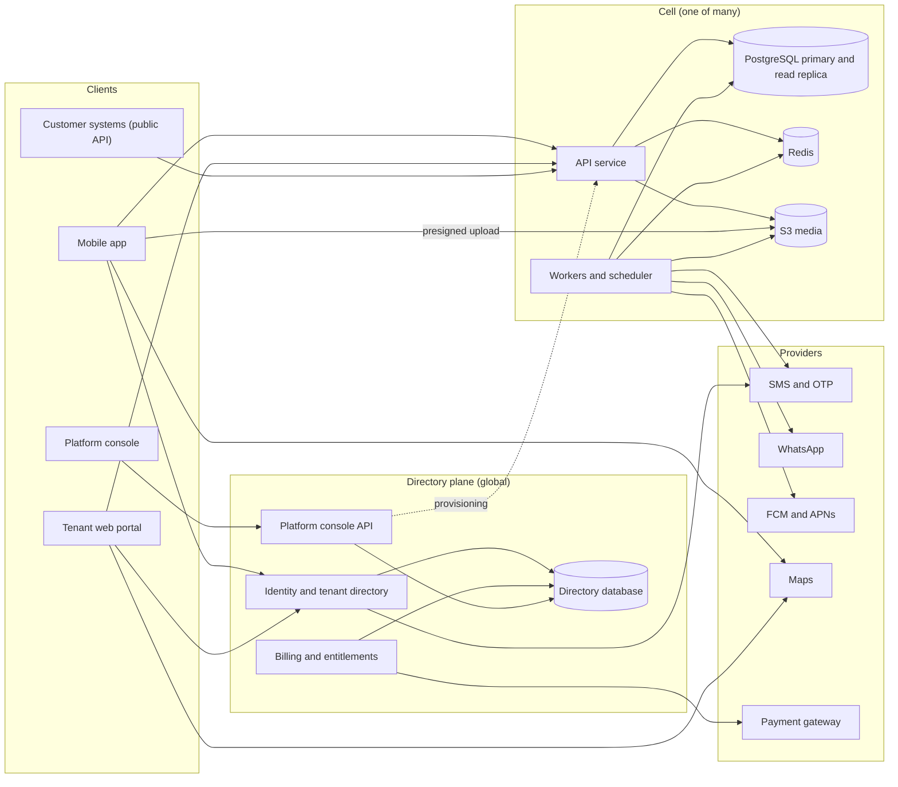

The directory plane is small and global. It knows identities (phone numbers and emails), which tenants each identity belongs to, which cell serves each tenant, and plans and invoices. Cells hold all tenant business data. Sign-in happens at the directory, and its response includes the tenant's cell URL; after that the app talks to the cell directly. Cells verify tokens with the directory's public keys (JWKS), so requests never call the directory.

In phases 0–2 the directory runs as a module inside the same deployable, with its own database schema and its own database role, and no code outside the module may touch that schema. It becomes a separate service when the second cell is created, as a deployment change.

### 9.4 Repository layout

```text
thelamp/
├── apps/
│   ├── api/                # NestJS. Entrypoints: main.ts (HTTP), worker.ts, scheduler.ts, migrate.ts, provision.ts, seed.ts
│   │   ├── src/modules/    # one folder per module (9.6)
│   │   ├── src/platform/   # auth guard, tenant context and RLS session, idempotency, errors, outbox, audit
│   │   ├── src/db/         # schema per module, migrations, seed (refuses non-local databases)
│   │   └── test/           # integration tests with Testcontainers; cross-tenant contract test
│   ├── web/                # tenant portal (Vite SPA)
│   ├── console/            # platform console (Vite SPA)
│   └── mobile/             # Expo app
├── packages/
│   ├── shared/             # types, zod schemas, error codes, business rules, pricing, calendars, scoring
│   ├── forms/              # form-definition schema, validator, field registry, visibility evaluator
│   ├── metrics/            # metric-definition schema and calculators
│   ├── i18n/               # string tables, terminology resolver, formatters
│   ├── templates/          # industry templates (JSON), schema, validator, loader
│   ├── api-client/         # typed client on the shared zod schemas: sessions, refresh and route calls
│   ├── design-tokens/      # design system: tokens.json (source) with generated CSS, TypeScript and ECharts theme; brand book and component guides
│   ├── ui-web/             # shared web components (React over the design system's reference CSS, Radix primitives where needed)
│   ├── ui-mobile/          # shared mobile components (React Native primitives and field patterns on design-tokens)
│   └── config/             # tsconfig, eslint and prettier presets
├── infra/terraform/
│   ├── modules/            # network, directory, cell, web-hosting, observability, dns
│   └── envs/               # dev, staging, prod, dedicated-<customer>
├── tools/                  # token build (tools/tokens), k6 load tests, data generators
├── docs/                   # decisions.md, versions.md, runbooks/, this specification
├── docker-compose.yml      # PostgreSQL with PostGIS, Redis, MinIO, Mailpit
└── CLAUDE.md
```

Conventions for `CLAUDE.md`:

- Commands: `pnpm dev`, `pnpm test`, `pnpm test:int`, `pnpm lint`, `pnpm typecheck`, `pnpm db:migrate`, `pnpm db:seed`, `pnpm openapi`.
- Naming: snake_case in the database, camelCase in TypeScript, kebab-case file names, kebab-case plural nouns in API paths.
- Each request and response has one zod schema in `packages/shared/src/schemas/<module>`; controllers never define ad hoc types.
- A module never imports another module's repository; cross-module calls go through exported services or events.
- Every new table gets `tenant_id`, an RLS policy, indexes led by `tenant_id`, and an entry in the cross-tenant test fixtures.

### 9.5 Tenancy and cells

Isolation layers:

1. Every tenant-owned table has `tenant_id uuid not null` and a policy `USING (tenant_id = current_setting('app.tenant_id')::uuid)` with a matching `WITH CHECK`.
2. The API opens a transaction per request and runs `SELECT set_config('app.tenant_id', $1, true)` with the token's tenant before any query. Workers do the same per job, using the tenant ID in the job payload.
3. The application connects as a role without `BYPASSRLS`. Migrations and cross-tenant maintenance (partition management, retention) use a separate role, only from the migrate and maintenance entrypoints.
4. Queries still filter by `tenant_id` explicitly, so indexes are used and a missing policy shows up in tests.
5. Object keys begin with the tenant ID, and presigned URLs are issued only after a scope check.

Cells:

- A cell contains its API service, workers, scheduler, a PostgreSQL primary and read replica, Redis and an S3 bucket or prefix. A shared cell is sized for about 20,000 concurrent field users.
- The directory maps each tenant to one cell and places new tenants in the cell with the most headroom.
- A dedicated cell serves one tenant: the licence model, data held in the customer's own AWS account, or a customer who requires physical isolation.
- Moving a tenant between cells uses the tenant export and import tooling (`pnpm tenant-move`, decision D95): freeze writes (`TENANT_MOVING`), export a signed move archive, import it, verify counts and checksums, switch the directory entry, unfreeze. A cell answers `TENANT_MOVED` for a tenant that lives elsewhere, and phones whose sync cursor names another cell take a full copy.
- Releases roll out cell by cell, starting with an internal canary cell.

Noisy-neighbour controls: per-tenant API rate limits by plan; per-tenant group concurrency on heavy queues (imports, exports, metrics); statement timeouts on report queries; import and export size limits by plan; exports and reports served from the read replica. Plans set them as `requestsPerMinute` (the whole tenant's requests, people and API clients together; open without one), `queueSlots` (its heavy jobs running at once on a queue; 2 without one), `importRows` (20,000 without one) and `exportRows` (100,000 without one); the console sets them per plan and per tenant (D98).

### 9.6 Backend modules

| Module | Responsibility | Owns |
|---|---|---|
| `directory` | Identities, memberships, OTP, tokens, SSO connections, tenant registry, cells | Directory schema |
| `billing` | Plans, subscriptions, invoices, payments, entitlements, seat counts | Directory schema |
| `platform` | Console API, support grants, feature flags, announcements | Directory schema |
| `tenant-config` | Settings, terminology, modules, branding, config bundle and its version | `tenant_settings`, `terminology_overrides`, `tenant_modules`, `review_rules` |
| `iam` | Users, roles, permissions, designations, devices, scope resolution | `users`, `roles`, `designations`, `devices`, `reporting_closure` |
| `territories` | Levels, nodes, user attachments | `territory_levels`, `territories`, `territory_closure`, `user_territories` |
| `accounts` | Account types, accounts, slots, contacts, location proposals, segments | `account_types`, `account_type_versions`, `accounts`, `account_slots`, `contacts`, `account_location_proposals` |
| `forms` | Form definitions and versions | `forms`, `form_versions` |
| `field` | Shifts, location ingest, trails, visits, submissions | `shifts`, `shift_pauses`, `location_points`, `shift_trails`, `user_last_position`, `visits`, `submissions` |
| `media` | Presign, confirm, processing results, signed reads | `media` |
| `review` | Review queue, decisions, auto-approval | `submission_reviews` |
| `planning` | Targets, routes, plan items, account plans | `target_sets`, `target_lines`, `routes`, `route_accounts`, `plan_items`, `account_plans` |
| `metrics` | Metric definitions, fact computation, scores, ranks | `metric_definitions`, `score_definitions`, `metric_facts_daily`, `metric_fact_accounts`, `external_metric_values`, `score_snapshots` |
| `catalogue` | Categories, products, items, units, price lists | `product_categories`, `products`, `items`, `item_units`, `price_lists`, `price_list_items` |
| `orders` | Orders and lines, decisions, fulfilment | `orders`, `order_lines` |
| `finance` | Snapshots and statement entries | `finance_snapshots`, `ledger_entries` |
| `hr` | Calendars, holidays, leave, regularisation, attendance days, payroll inputs | `calendars`, `holidays`, `leave_types`, `leave_requests`, `leave_year_closings`, `regularisations`, `attendance_days`, `payroll_gross` |
| `expenses` | Policies and claims | `expense_policies`, `expense_policy_versions`, `expense_claims` |
| `workflow` | Definitions, instances, steps, SLA timers, delegations | `workflow_definitions`, `workflow_instances`, `workflow_steps`, `approval_delegations` |
| `notifications` | Templates, preferences, delivery, in-app inbox | `notification_templates`, `notifications`, `notification_prefs` |
| `imports`, `exports` | File-based jobs | `import_jobs`, `import_mappings`, `export_jobs` |
| `integrations` | API clients, webhooks, deliveries | `api_clients`, `webhook_subscriptions`, `webhook_deliveries` |
| `sync` | Mobile pull protocol and change cursors | `sync_tombstones` |
| `audit` | Writing and viewing the audit log | `audit_log` |
| `outbox` | Domain event persistence and dispatch | `outbox_events`, `idempotency_keys` |

## 10. Data model

### 10.1 Conventions

- Primary keys are UUID version 7 (time-ordered, good index locality). Device-created records get their ID on the device: shifts, location points, visits, submissions, media, orders, claims, leave and regularisation requests.
- Every tenant-owned table has `tenant_id` first in its primary or unique keys and in its main indexes.
- Times are `timestamptz` in UTC. Calendar dates (plan items, holidays, leave, statement entries) are `date` values in the tenant timezone. Periods are text `YYYY-MM`; target and score periods may also be a quarter `FYYYYY-Qn` or a year `FYYYYY` of the tenant's financial year, named by the year it starts in (D108).
- Money is `numeric(18,2)`, percentages `numeric(7,4)`, quantities `numeric(18,3)`. The shared package uses a decimal library for pricing and converts only at the edges; money never passes through binary floating point in calculations.
- Locations are `geography(Point, 4326)` with GiST indexes.
- Fixed system statuses use PostgreSQL enums. Tenant-defined data (custom fields, form data, settings, workflow steps) is `jsonb`, validated in the application against the versioned definition. Frequently filtered custom fields can be promoted to indexed generated columns.
- Syncable tables have `row_version bigint`: the ID of the transaction that last wrote the row, set on insert and by trigger on update, so a pull never moves its cursor past a row that isn't visible yet (decision D40). Removals are status changes or rows in `sync_tombstones`.
- Application code never hard-deletes, except retention jobs and tenant deletion.
- Mutable tables carry `created_at`, `created_by`, `updated_at` and `updated_by`.

### 10.2 Core entities

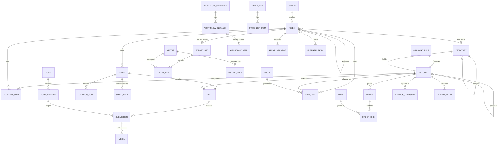

### 10.3 Table catalogue

Columns are condensed; `tid` stands for `tenant_id`. PK = primary key, UQ = unique, IX = index, GIST = spatial index, GIN = inverted index, PART = partitioned.

```text
── Directory schema (global; no RLS; directory role only) ────────────────────────
tenants(id, slug UQ, name, status enum(trial,active,grace,read_only,suspended,terminated), cell_id, moving_to_cell_id NULL,
        terminated_at NULL, deleted_at NULL,
        plan_id, template_key, template_version, created_at)
cells(id, name, region, api_base_url, kind enum(shared,dedicated), status, capacity_users)
identities(id, phone_e164 UQ, email UQ NULL, created_at, last_login_at)
memberships(id, identity_id, tenant_id, user_id, status, auth_revision)
            UQ(tenant_id, user_id) · UQ(identity_id, tenant_id) WHERE status = 'active'
otp_challenges(id, identity_key, code_hmac, channel, attempts, expires_at, consumed_at, ip, created_at)
refresh_tokens(id, membership_id, device_id NULL, token_hash UQ, family_id, auth_revision,
               expires_at, revoked_at, created_at)                            IX(family_id)
totp_secrets(identity_id PK, secret_sealed, enabled_at, last_step, recovery_hashes text[])
sso_connections(tenant_id PK, protocol enum(oidc,saml), config_sealed, domains text[], enabled, enforced)
platform_users(id, email UQ, name, role, status)
support_grants(id, tenant_id, platform_user_id, reason, scope enum(read,write), hours, emergency,
               granted_scope, approved_by_user_id, approved_by_staff_id, approved_by_name, starts_at,
               ends_at, declined_at, revoked_at, closed_by_user_id, closed_by_staff_id, closed_by_name)
announcements(id, title jsonb, body jsonb, tone enum(info,warning), surfaces text[], tenant_ids uuid[] NULL,
              starts_at, ends_at, created_by, created_at, withdrawn_at, withdrawn_by)
cell_health(cell_id, at, figures jsonb)                      PK(cell_id, at) · kept two days
plans(id, key UQ, name, price_month, price_year, modules text[], limits jsonb, addons jsonb, active)
billing_accounts(tenant_id PK, legal_name, gstin, address, state_code, email, language,
                 mandate_status, mandate_ref)
subscriptions(id, tenant_id, plan_id, cycle, committed_seats, status, started_on, term_start,
              term_end, ends_on, dunning_stage)                 UQ(tenant_id) WHERE active
invoices(id, tenant_id, subscription_id, number UQ, kind, period_from, period_to, issued_on,
         due_on, seller jsonb, buyer jsonb, lines jsonb, subtotal, gst_rate, cgst, sgst, igst,
         total, status, charge_failed_at, provider_ref)     UQ(subscription_id, kind, period_from)
payments(id, invoice_id, tenant_id, amount, method, reference, received_on, provider_ref UQ)
invoice_sequences(series PK, last) · billing_notices(tenant_id, key) PK · platform_settings(key PK, value)
usage_records(tenant_id, period, metric, quantity)                           PK(tenant_id, period, metric)

── Configuration and identity (cell) ─────────────────────────────────────────────
tenant_settings(tid PK, settings jsonb, config_version bigint, updated_at, updated_by)
terminology_overrides(tid, key, locale, value)                               PK(tid, key, locale)
tenant_modules(tid, module, enabled)                                         PK(tid, module)
review_rules(tid PK, rules jsonb, updated_by, updated_at)
designations(id, tid, key, name jsonb, level, default_role_id, can_have_reports, ranked)  UQ(tid, key)
roles(id, tid, key, name, permissions text[], scope enum, mobile_only, system bool)  UQ(tid, key)
users(id, tid, code, name, phone_e164, email, designation_id, role_id, manager_id NULL, calendar_key NULL,
      joining_date, exit_date, status enum(active,inactive), auth_revision, custom jsonb, row_version)
      UQ(tid, code) · UQ(tid, phone_e164) · IX(tid, manager_id)
reporting_closure(tid, ancestor_id, descendant_id, depth)                    PK(tid, ancestor_id, descendant_id)
devices(id, tid, user_id, device_key_hash, platform enum(android,ios,web), model, os_version, app_version,
        push_token, integrity_verdict, health jsonb, bound_at, last_seen_at, revoked_at)
territory_levels(tid, level, key, name jsonb)                                PK(tid, level) · UQ(tid, key)
territories(id, tid, level, parent_id, code, name, owner_user_id, active, row_version)  UQ(tid, code)
territory_closure(tid, ancestor_id, descendant_id, depth)
user_territories(tid, user_id, territory_id, valid_from, valid_to)
user_fields(tid PK, fields jsonb, retired jsonb, updated_at, updated_by)
user_transfers(id, tid, user_id, effective_date, changes jsonb, status enum(scheduled,applied,cancelled,failed),
               reason, created_at, created_by, applied_at, cancelled_at, cancelled_by)   IX(tid, user_id, effective_date)

── Accounts ──────────────────────────────────────────────────────────────────────
account_types(id, tid, key, current_version, active, next_number)           UQ(tid, key)
account_type_versions(tid, account_type_id, version, definition jsonb, published_at, published_by)
       PK(tid, account_type_id, version)
accounts(id, tid, type_id, code, name, territory_id, parent_account_id NULL, address jsonb,
         location geography NULL, geofence_radius_m NULL, location_status enum(unverified,verified),
         status enum(pending,active,inactive), segments text[], custom jsonb, row_version)
         UQ(tid, code) · IX(tid, territory_id) · GIST(location) · GIN(name gin_trgm_ops)
account_slots(tid, account_id, slot_key, user_id, valid_from, valid_to)      IX(tid, user_id)
contacts(id, tid, account_id, name, role, phone, email, custom jsonb, active, row_version)
account_location_proposals(id, tid, account_id, proposed_by, point, accuracy, captured_at,
         workflow_instance_id, status enum(pending,approved,rejected,cancelled), created_at, decided_at)

── Forms and field work ──────────────────────────────────────────────────────────
forms(id, tid, key, current_version, active)                                 UQ(tid, key)
form_versions(tid, form_id, version, definition jsonb, published_at, published_by)
                                                                             PK(tid, form_id, version)
shifts(id, tid, user_id, device_id, started_at, start_point, start_accuracy, consent_version,
       selfie_media_id NULL, start_odometer NULL, start_odometer_media_id NULL, ended_at NULL,
       end_point NULL, end_accuracy NULL, end_odometer NULL, end_odometer_media_id NULL,
       end_reason enum(punch_out,auto_closed,max_length,admin) NULL, distance_m NULL,
       on_duty_seconds NULL, clock_skew, compacted_at NULL, received_at)
       IX(tid, user_id, started_at) · UQ(tid, user_id) WHERE ended_at IS NULL
shift_pauses(id, tid, shift_id, paused_at, resumed_at NULL, reason)  UQ(tid, shift_id) WHERE resumed_at IS NULL
location_points(tid, id, shift_id, user_id, captured_at, received_at, point, accuracy, speed NULL,
       source enum(foreground,background), battery NULL)
       PART daily on captured_at · PK(tid, captured_at, id) · IX(tid, shift_id, captured_at)
shift_trails(tid, shift_id, user_id, date, polyline text, point_count, kept_count, distance_m,
       gaps jsonb, pauses jsonb, archived_key)            PK(tid, shift_id) · IX(tid, user_id, date)
user_last_position(tid, user_id PK, shift_id, captured_at, point, accuracy, battery)
visits(id, tid, user_id, shift_id, account_id, plan_item_id NULL, device_id NULL, check_in_at,
       check_in_point, check_in_accuracy, distance_m NULL, geofence enum(inside,outside,unknown),
       check_out_at NULL, check_out_point NULL, check_out_accuracy NULL,
       end_reason enum(check_out,next_check_in,punch_out,idle) NULL, clock_skew, received_at)
       IX(tid, account_id, check_in_at) · IX(tid, user_id, check_in_at) · one open per user
submissions(id, tid, user_id, shift_id NULL, visit_id NULL, account_id NULL, plan_item_id NULL,
       form_id, form_version, captured_at, received_at, point, accuracy, gps_at, mocked,
       data jsonb, photo_ids uuid[], signature_strokes jsonb NULL, signature_media_id NULL,
       distance_m NULL, geofence enum NULL, flags enum[],
       status enum(pending,approved,rejected), auto_approved, auto_approve_at NULL, device_id, row_version)
       IX(tid, user_id, captured_at) · IX(tid, status, captured_at) · IX(tid, account_id, captured_at) · GIST(point)
submission_reviews(id, tid, submission_id, decision enum(approved,rejected), note NULL, reviewer_id NULL,
       auto, created_at)                                          IX(tid, submission_id, created_at)
media(id, tid, user_id, kind enum(evidence,field_photo,selfie,attachment,receipt,odometer,signature,
      import_file,export_file), object_key, file_name NULL, content_type, size, sha256,
      status enum(pending,uploaded,processed,rejected,deleted), source enum(camera,gallery,generated),
      captured_at, point, accuracy, mocked, dhash NULL, duplicate_of_id NULL, ocr jsonb NULL,
      derivatives jsonb, reject_reason NULL, owner_type, owner_id NULL, retention_class,
      created_at, confirmed_at, processed_at)                        IX(tid, kind, captured_at)
      IX(tid, sha256) · IX(tid, kind, dhash) · IX(tid, owner_type, owner_id)

── Planning and metrics ──────────────────────────────────────────────────────────
metric_definitions(tid, key, version, definition jsonb, targetable, active, created_at)
       PK(tid, key) · definition holds the names, unit, direction, source, filters, scoring and
       visible roles, as the template has them (D55)
score_definitions(tid, version, definition jsonb, created_at)                PK(tid) · the template's
       score definition: period type, cap, ranking groups and weighted metrics (D56)
target_sets(id, tid, user_id, period, status enum(draft,locked), locked_at, locked_by, version,
       updated_at, updated_by)
       UQ(tid, user_id, period)
target_lines(tid, target_set_id, metric_key, value)                         PK(tid, target_set_id, metric_key)
routes(id, tid, user_id, name, recurrence jsonb, active)                     IX(tid, user_id)
route_accounts(tid, route_id, account_id, seq)                               PK(tid, route_id, account_id)
plan_items(id, tid, user_id, account_id, date, purpose, note,
       status enum(planned,visited,completed,missed,cancelled), source enum(route,adhoc),
       route_id NULL, visit_id NULL, row_version)                            IX(tid, user_id, date)
       UQ(tid, route_id, account_id, date) where route_id is set
plan_months(tid, user_id, period, status enum(draft,submitted,approved,rejected), request_id NULL,
       approval_id NULL)                                                     PK(tid, user_id, period)
account_plans(tid, account_id, period, metric_key, value, updated_at, updated_by)
       PK(tid, account_id, period, metric_key)
metric_facts_daily(tid, user_id, date, metric_key, value, numerator, denominator, pending,
       computed_at)                                                          PK(tid, user_id, date, metric_key)
       · unpartitioned at launch, partitioned monthly on date when volume needs it (D56)
metric_fact_accounts(tid, user_id, date, metric_key, account_id)
       PK(tid, user_id, date, metric_key, account_id) · the accounts behind a day's distinct count
external_metric_values(tid, user_id NULL, account_id NULL, date, metric_id, value, source, import_id)
score_snapshots(tid, period, user_id, score NULL, rank NULL, group_key, computed_at)

── Catalogue, orders and finance ─────────────────────────────────────────────────
catalogue_settings(tid, units jsonb, measure_types, rounding, item_fields jsonb,
         rejection_reasons jsonb, version)                                   PK(tid)
product_categories(id, tid, parent_id, name)
products(id, tid, category_id, name, custom jsonb)
items(id, tid, product_id, code, name, pack_label, hsn, tax_rate, mrp, base_unit, measure_type NULL,
      measure_per_base_unit NULL, custom jsonb, active, row_version)         UQ(tid, lower(code))
item_units(item_id, unit_key, factor, sellable)                              PK(item_id, unit_key)
price_lists(id, tid, name, priority, applies_to jsonb, valid_from, valid_to, active)
price_list_items(price_list_id, item_id, price, discount_pct)                PK(price_list_id, item_id)
orders(id, tid, account_id, supplier_kind enum(company,account), supplier_account_id NULL, user_id,
       visit_id NULL, shift_id NULL, placed_at, received_at, point, accuracy, price_list_id,
       subtotal, tax_total, total, note, status enum, rejection_reason, workflow_instance_id,
       request_hash, row_version)                                            IX(tid, placed_at) · IX(tid, account_id, placed_at)
order_lines(id, tid, order_id, position, item_id, snapshot jsonb, unit_key, quantity, factor,
       base_units, measure_type, measure_total, rate, taxable, tax, total,
       decision enum(pending,accepted,rejected), decision_reason, fulfilled_units NULL)
finance_snapshots(id, tid, account_id, as_of, outstanding, credit_limit, inventory_value, ageing jsonb,
       source, created_by, created_at)                                       IX(tid, account_id, as_of DESC)
ledger_entries(id, tid, account_id, date, reference, description, debit, credit, source,
       import_id NULL, created_by, created_at)                               UQ(tid, reference) · IX(tid, account_id, date)

── People operations ─────────────────────────────────────────────────────────────
calendars(tid, key, name jsonb, weekly_offs int[], is_default)               PK(tid, key) · one default (D80)
holidays(tid, calendar_key, date, name, optional, active)                     PK(tid, calendar_key, date)
leave_types(tid, key, name jsonb, paid, annual_quota, quota_year enum(calendar,financial),
       half_day_allowed, attachment_after_days, active, accrual enum(yearly,monthly),
       carry_forward_max, position)                                          PK(tid, key) (D81, D114)
leave_year_closings(tid, user_id, leave_type_key, year_from, year_to, credited, carried_in, taken,
       carried_out, lapsed, cap, closed_at)               PK(tid, user_id, leave_type_key, year_from) (D114)
leave_requests(id, tid, user_id, leave_type_key, start_date, end_date, half_day, days, reason,
       attachment_id, status enum(pending,approved,rejected,cancelled), workflow_instance_id,
       created_at, decided_at)                                               IX(tid, user_id, start_date, end_date)
regularisations(id, tid, user_id, date, requested enum(present,half_day), reason, status,
       workflow_instance_id)                         UQ(tid, user_id, date) WHERE status IN ('pending','approved')
attendance_days(tid, user_id, date, status, value, first_in, last_out, hours, source jsonb, computed_at)
       PK(tid, user_id, date) · PART monthly once volumes need it (D47)
attendance_policies(tid, rule jsonb)                                         PK(tid)
payroll_gross(tid, user_id, from_period, monthly_gross, updated_by, updated_at) PK(tid, user_id, from_period) (D117)
expense_policies(tid, key, current_version, active, position)                PK(tid, key) (D83)
expense_policy_versions(tid, policy_key, version, definition jsonb, valid_from) PK(tid, policy_key, version)
expense_claims(id, tid, user_id, policy_key, policy_version, expense_date, description, quantity,
       rate, odometer_open NULL, odometer_close NULL, bill_amount NULL, calculated, amount, capped,
       shift_id NULL, odometer_changed, tracked_km NULL, status, paid_at NULL, paid_by NULL, payment_reference NULL,
       workflow_instance_id, created_at, decided_at)     receipts and odometer photos are media owned by the claim

── Workflow, notifications, integration and operations ──────────────────────────
workflow_definitions(id, tid, request_type, version, steps jsonb, fallback_role_id, active)
workflow_instances(id, tid, definition_id NULL, request_type, request_id, requester_id, current_step,
       status enum(pending,approved,rejected,cancelled), version int, created_at, closed_at)
workflow_steps(instance_id, step_index, approver_ids uuid[],
       status enum(waiting,pending,approved,rejected,skipped), acted_by NULL, acted_at NULL,
       on_behalf_of NULL, note, due_at NULL)
       PK(instance_id, step_index)
approval_delegations(id, tid, delegator_id, delegate_id, starts_on, ends_on, note, created_by,
       ended_at NULL, ended_by NULL)                     IX(tid, delegator_id, ends_on) · IX(tid, delegate_id, ends_on) (D113)
notification_templates(id, tid NULL, event, channel, locale, body, provider_template NULL)
notifications(id, tid, user_id, event, category, values jsonb, link, dedupe_key, inbox, read_at,
       created_at)                                       UQ(tid, user_id, dedupe_key) · the inbox entry
notification_deliveries(id, tid, notification_id, channel, status enum(queued,held,sent,failed,skipped),
       address, provider_ref, error, cost_units, attempts, not_before, created_at, sent_at)
       · unpartitioned at launch, partitioned monthly when volume needs it (D58)
push_tokens(tid, device_id, user_id, token, locale, updated_at)              PK(tid, device_id)
notification_prefs(tid, user_id, category, muted)
import_jobs(id, tid, target, file_media_id, file_name, sheets jsonb, sheet, header_row, headers jsonb,
       mapping jsonb, status enum(reading,mapping,validating,ready,invalid,committing,committed,failed),
       total_rows, error_rows, errors jsonb, preview jsonb, created, updated, created_by, created_at,
       updated_at, finished_at)                                              IX(tid, created_at)
import_mappings(id, tid, target, name, mapping jsonb, empty_values jsonb, fractions jsonb, created_by,
         updated_at)
       UQ(tid, target, name)
export_jobs(id, tid, kind, params jsonb, status, file_media_id NULL, error, requested_by, created_at, finished_at)
api_clients(id, tid, name, client_id UQ(tid, client_id), secret_hash, scopes text[], status, auth_revision,
            last_used_at, revoked_at)
external_metric_values(tid, id, metric_key, user_id NULL, account_id NULL, date, month bool, value,
            credited_user_id, updated_at)  UQ NULLS NOT DISTINCT(tid, metric_key, user_id, account_id, date)
webhook_subscriptions(tid, id, url, events text[], description NULL, secret_sealed, status active|paused)
webhook_messages(tid, id, subscription_id, event_id NULL, event, body jsonb, status pending|delivered|failed,
            attempts, first_attempt_at NULL, next_attempt_at NULL)  UQ(tid, subscription_id, event_id)
webhook_deliveries(tid, id, subscription_id, message_id, attempt, status, response_code NULL, duration_ms,
            error NULL, created_at)  PART monthly
outbox_events(id, tid, type, aggregate_id, payload jsonb, created_at, attempts, next_attempt_at, last_error NULL,
       dispatched_at NULL)
data_exports(tid, id, status, requested_by NULL, requester_name, file_media_id NULL, size, sha256, table_count,
            row_count, file_count, key_id, error NULL, created_at, finished_at NULL, expires_at NULL)
data_requests(tid, id, user_id, kind access|correction|erasure, status received|completed|refused, details,
            response NULL, self, raised_by_name, due_on, archive_status NULL, archive_media_id NULL,
            archive_size NULL, archive_sha256 NULL, archive_expires_at NULL, created_at, closed_at NULL,
            closed_by_name NULL)
       IX(next_attempt_at) WHERE dispatched_at IS NULL
idempotency_keys(tid, key, request_hash, response jsonb, created_at)       PK(tid, key) · purged after 7 days
sync_tombstones(tid, entity, entity_id, row_version, created_at)
audit_log(id, tid, actor_id, actor_kind enum(user,platform,system,api_client), action, target_type, target_id,
       before jsonb, after jsonb, ip, device_id, support_grant_id NULL, created_at)  PART monthly
```

### 10.4 High-volume tables

| Table | Strategy |
|---|---|
| `location_points` | Daily range partitions managed by pg_partman. Raw points live for the tenant's hot retention (35 days by default). A nightly job compacts each finished shift into `shift_trails` (accuracy-filtered, simplified polyline plus statistics), writes the tenant's raw points of each settled day to S3 as compressed Parquet, deletes each tenant's archived points after its own hot retention, and drops a day's partition once it is empty and past the longest hot retention (decision D69). The primary key `(captured_at, id)` keeps replays idempotent inside a partition. Sizing: a cell with 20,000 on-duty users stores about 11 million points a day, roughly 3 GB with indexes, so 35 days of hot data is about 100 GB. |
| `submissions` | Unpartitioned at launch, with indexes led by `tenant_id`. Partition by month on `captured_at` once a cell passes about 200 million rows, and move idempotency checks to `idempotency_keys` at that point. |
| `metric_facts_daily`, `attendance_days` | Monthly partitions. Dashboards and registers read only these tables. |
| `audit_log`, `notifications`, `webhook_deliveries` | Monthly partitions; retention by dropping partitions. |
| `outbox_events` | Dispatched rows deleted after 3 days. |

Exports, reports and bulk reads from the public API run on the read replica. Writes, and reads that must see their own writes, use the primary. The replica's reads are read only, in one snapshot, with each statement stopped after its timeout; a cell without a replica reads its primary the same way (D98).

## 11. API and sync

### 11.1 Conventions

| Topic | Rule |
|---|---|
| Base paths | Cell API `https://<cell-host>/v1/...`; directory `https://<directory-host>/auth/v1/...`; platform console `https://<directory-host>/platform/v1/...`; `/health` (liveness) and `/ready` (readiness) on every service |
| Format | JSON, UTF-8, camelCase fields |
| Authentication | `Authorization: Bearer <access token>`. Claims: `sub` (user), `tid` (tenant), `cell`, `did` (device), `rev` (auth revision), `scp` (scopes, for API clients). |
| Request headers | `X-Device-Time` (for BR-44), `X-App-Platform` and `X-App-Version` from the mobile app (checked against the platform's minimum, M1 rule 8), `X-Request-Id` (echoed back), `Idempotency-Key` for creates without a client ID |
| IDs | UUIDv7; client-generated for device records |
| Time and location | ISO 8601 with offset; dates `YYYY-MM-DD`; a GPS fix is `{ lat, lng, accuracy, fixTime, mocked, speed? }` |
| Money | Decimal strings in responses (`"10195.20"`); requests accept numbers or strings and parse them as decimals |
| Validation | zod schemas from `packages/shared`, which also generate the OpenAPI document |
| Errors | `{ "error": { "code": "PRICE_CHANGED", "message": "...", "details": [{ "path": "items[0].price", "issue": "..." }], "requestId": "..." } }` |
| Pagination | Cursor-based: `?limit=50&cursor=...` returns `{ items, nextCursor }` |
| Filtering and sorting | Explicit query parameters per endpoint |
| Caching | `ETag` on configuration and catalogue endpoints; clients send `If-None-Match` |
| Rate limits | Per user (600 requests a minute by default, `USER_REQUESTS_PER_MINUTE`, D101), per tenant and per API client; `429` with `Retry-After` |
| Versioning | Additive changes within `/v1`; breaking changes go to `/v2`; minimum app version enforced per platform |

### 11.2 Endpoint groups

This list fixes the shape of the API. The OpenAPI document generated from the code is the detailed contract.

| Group | Representative endpoints |
|---|---|
| Auth (directory) | `POST /auth/v1/otp/request`, `POST /auth/v1/otp/verify`, `POST /auth/v1/token/refresh`, `POST /auth/v1/logout`, `GET /auth/v1/jwks`, `POST /auth/v1/totp/setup`, `POST /auth/v1/totp/verify`, `POST /auth/v1/sso/discover`, `GET /auth/v1/sso/:tenant/start`, `GET /auth/v1/sso/:tenant/oidc/callback`, `POST /auth/v1/sso/:tenant/saml/acs`, `GET /auth/v1/sso/:tenant/saml/metadata` |
| Me and config | `GET /v1/me`, `GET /v1/config` (settings, terminology, modules, effective permissions, current form versions, account types, metrics; ETag), `PATCH /v1/settings`, `GET /v1/terminology`, `PUT /v1/terminology`, `GET /v1/organisation`, `PATCH /v1/organisation`, `PUT /v1/organisation/logo`, `DELETE /v1/organisation/logo` (decision D64), `POST /v1/devices/heartbeat`, `PUT /v1/devices/push-token` |
| Sync | `GET /v1/sync/pull?entities=...&cursor=...` |
| People | `GET /v1/users`, `GET /v1/users/:id`, `POST /v1/users`, `PATCH /v1/users/:id`, `POST /v1/users/:id/reset-device`, `POST /v1/users/:id/sign-out-everywhere`, `GET /v1/users/:id/history`, `POST /v1/users/:id/transfers`, `GET /v1/users/:id/transfers`, `POST /v1/users/:id/transfers/:transferId/cancel`, `GET /v1/org-chart`, `GET /v1/user-fields`, `PUT /v1/user-fields`, `GET /v1/roles`, `POST /v1/roles`, `PATCH /v1/roles/:id`, `GET /v1/designations`, `POST /v1/designations`, `PATCH /v1/designations/:id` |
| Territories | `GET /v1/territories`, `POST /v1/territories`, `PATCH /v1/territories/:id`, `PUT /v1/territories/levels` (rename levels, or add them at the bottom; decision D65) |
| Accounts | `GET /v1/accounts`, `POST /v1/accounts`, `PATCH /v1/accounts/:id`, `GET /v1/accounts/:id/overview`, `POST /v1/accounts/:id/contacts`, `PATCH /v1/accounts/:id/contacts/:contactId`, `POST /v1/accounts/:id/location-proposals`, `GET /v1/account-types`, `POST /v1/account-types` (decision D65), `POST /v1/account-types/:id/versions` |
| Forms | `GET /v1/forms`, `POST /v1/forms`, `POST /v1/forms/:id/versions` (publish), `PATCH /v1/forms/:id` (switch off or on) |
| Field | `POST /v1/shifts`, `GET /v1/shifts/current`, `GET /v1/shifts?userId`, `POST /v1/shifts/:id/end`, `POST /v1/shifts/:id/pauses`, `POST /v1/shifts/:id/pauses/:pauseId/resume`, `POST /v1/locations/batch`, `GET /v1/attendance?userId&period` (attendance days from shifts until HR arrives, D47), `POST /v1/visits`, `GET /v1/visits/current`, `POST /v1/visits/:id/check-out`, `POST /v1/submissions`, `GET /v1/submissions` |
| Review | `GET /v1/reviews/queue`, `POST /v1/submissions/:id/review`, `POST /v1/reviews/bulk`, `GET /v1/review-rules`, `PUT /v1/review-rules` |
| Media | `POST /v1/media/presign`, `POST /v1/media/:id/confirm`, `GET /v1/media/:id/url?variant=` |
| Planning | `GET /v1/metrics`, `GET /v1/targets`, `PUT /v1/targets`, `POST /v1/targets/lock`, `POST /v1/targets/unlock`, `POST /v1/targets/copy`, `GET /v1/routes`, `POST /v1/routes`, `PATCH /v1/routes/:id`, `POST /v1/plans/generate`, `POST /v1/plans/submit`, `GET /v1/plan-items`, `POST /v1/plan-items`, `POST /v1/plan-items/:id/cancel`, `GET /v1/account-plans`, `PUT /v1/account-plans` |
| Performance | `GET /v1/performance?period&userId`, `GET /v1/performance/team?period`, `GET /v1/leaderboard?period&group`, `GET /v1/metric-definitions`, `POST /v1/metrics`, `PUT /v1/metrics/:key` (with the day facts are worked out again from), `PUT /v1/score` (decision D65) |
| Maps | `GET /v1/live` (read again every 30 seconds, decision D60), `GET /v1/account-pins?period`, `GET /v1/trails?userId&date`, `GET /v1/density?period` |
| Catalogue | `GET /v1/catalogue` (items and units; ETag), `PUT /v1/items/{id}`, `GET /v1/price-lists`, `GET` and `PUT /v1/price-lists/{id}`, `GET` and `PUT /v1/price-lists/{id}/items`, `GET /v1/accounts/{id}/prices` (the lists that apply and each item's price). Phones keep the price lists that can apply to their accounts through the sync (D38, D45, D77). |
| Orders | `POST /v1/orders`, `GET /v1/orders`, `GET /v1/orders/:id`, `POST /v1/orders/:id/decision`, `POST /v1/orders/:id/line-decisions`, `POST /v1/orders/:id/fulfilment` |
| Finance | `POST /v1/finance-snapshots`, `POST /v1/ledger-entries`, `GET /v1/accounts/:id/statement` |
| HR | `GET /v1/attendance?userId&period`, `POST /v1/leave-requests`, `POST /v1/regularisations`, `GET /v1/calendars`, `PUT /v1/calendars`, `PUT /v1/leave-types`, `GET /v1/payroll?period`, `GET /v1/payroll-gross/:userId`, `PUT /v1/payroll-gross/:userId`, `GET /v1/payslips/:userId/:period` |
| Expenses | `PUT /v1/expense-policies`, `POST /v1/expense-claims`, `POST /v1/expense-claims/:id/receipts`, `POST /v1/expense-claims/:id/paid` |
| Approvals | `GET /v1/approvals/inbox`, `GET /v1/approvals/:instanceId`, `POST /v1/approvals/:instanceId/decision`, `POST /v1/approvals/:instanceId/cancel`; the chains: `GET /v1/workflows`, `PUT /v1/workflows/:requestType` (a new version), `PUT /v1/workflows/fallback` (decision D74) |
| Notifications | `GET /v1/notifications`, `POST /v1/notifications/read`, `GET /v1/notification-prefs`, `PUT /v1/notification-prefs`, `PUT /v1/push-tokens` |
| Configuration | `GET /v1/configuration/export`, `POST /v1/configuration/import/preview`, `POST /v1/configuration/import` (the configuration as an industry template; an import adds and updates, never removes; decision D66) |
| Reports | `GET /v1/dashboard?period` (the home dashboard, decision D63), `GET /v1/reports/:key?period&managerId&territoryId&userId&accountType&form&locale` (decision D62) |
| Imports and exports | `POST /v1/imports`, `GET /v1/imports`, `PUT /v1/imports/:id/mapping`, `POST /v1/imports/:id/commit`, `GET /v1/imports/:id`, `POST /v1/exports`, `GET /v1/exports`, `GET /v1/exports/:id` |
| Integrations | `GET /v1/api-clients`, `POST /v1/api-clients`, `GET /v1/webhooks`, `POST /v1/webhooks`, `PATCH /v1/webhooks/:id`, `POST /v1/webhooks/:id/rotate`, `POST /v1/webhooks/:id/test`, `GET /v1/webhooks/:id/deliveries`, `POST /v1/webhooks/:id/messages/:messageId/replay`, `POST /v1/bulk/users`, `POST /v1/bulk/accounts`, `POST /v1/bulk/items`, `POST /v1/bulk/ledger-entries`, `POST /v1/bulk/external-metrics` |
| Audit and data | `GET /v1/audit`, `GET /v1/me/data-requests`, `POST /v1/me/data-requests`, `GET /v1/data-requests`, `POST /v1/data-requests`, `GET /v1/data-requests/:id`, `POST /v1/data-requests/:id/archive`, `POST /v1/data-requests/:id/close`, `GET /v1/data-exports`, `POST /v1/data-exports`, `GET /v1/data-exports/:id`, `GET /v1/data-exports/signing-key` |
| Platform console | `POST /platform/v1/tenants`, `PATCH /platform/v1/tenants/:id`, `GET /platform/v1/usage`, `POST /platform/v1/support-grants`, plus plans, invoices and feature flags |

### 11.3 Mobile sync protocol

Storage on the phone (SQLite in WAL mode):

| Store | Contents |
|---|---|
| Reference tables | What the user may read offline: config bundle, own profile, users in scope (managers), territories, accounts in scope with contacts, catalogue with applicable prices, routes and plan items for the current and next month, own target sets and metric summaries, leave types and balances, expense policies, own recent submissions, orders and requests |
| `sync_state` | Last cursor per entity and last full refresh time |
| `outbox` | Ordered queue: `seq`, `id`, `kind`, `payload`, `depends_on`, `attempts`, `next_attempt_at`, `last_error`, `state` (`queued` or `parked`) |
| `form_entries` | Forms being filled and submitted ones waiting to be sent, each with the form version it was started on, its values, photos and signature strokes, and its state (`draft` or `queued`); a queued entry moves to the outbox once submissions can be sent (D46) |
| `shift_state` | The open shift the background task reads: its ID, start, longest end, interval and open pause (D48) |
| `location_buffer` | Points waiting to upload; they go once their shift's punch-in has reached the server (D48) |
| Files | Compressed photos waiting to upload, in app-private storage |
| Secure store | Tokens and the device key, readable after first unlock so the background task can upload |

Pull, from server to device:

1. `GET /v1/sync/pull?entities=accounts,plan_items,...&cursor=<opaque>` returns, per entity, rows with `row_version` above the cursor that fall inside the user's sync scope, plus tombstones and a new cursor. Pages hold up to 500 rows per entity.
2. Scope changes (an account reassigned away from the user) arrive as a full pass of that entity: the server sends every row the user may now hold, and the phone drops the rows the pass did not send (decision D40). Rows removed for everyone arrive as tombstones.
3. The config bundle and catalogue use ETags; a changed `config_version` triggers a refetch.
4. A full refresh runs on first sign-in, after a tenant switch, and when the server answers `SYNC_RESET` (cursor too old or schema changed).

Push, from device to server:

1. Every capture writes its records to the outbox in one local transaction. Media items are enqueued before the records that reference them and recorded as dependencies.
2. One sync runner at a time takes the oldest queued item whose dependencies are done.
3. Success removes the item. A transient failure (no network, 5xx, 429, or a 401 that a token refresh fixes) sets `next_attempt_at = now + min(15 min, 5 s × 2^attempts)` and ends the run, so order is kept. A permanent failure (any other 4xx) parks the item with the server's message, and items that depend on it wait.
4. The upload queue screen lists every item with its state and last error. Parked items can be retried or discarded; discard asks for confirmation and deletes the local file.
5. Sync runs after each capture, when the app returns to the foreground, when connectivity returns, every 60 s while the app is open, and from the background location task for location points.

Conflicts: records created on the device are immutable once sent, so they never conflict. Reference data belongs to the server, and the server version always wins. A record that references something no longer valid (an account deactivated while the user was offline) is parked with a clear message.

Sign-out and resets: sign-out clears reference data and keeps unsent outbox items, which upload after the same user signs in again on the same device. A device reset revokes the device, so managers should ask the user to sync first; the reset screen shows the device's last reported queue size.

App upgrades: local database migrations are versioned and run at app start before any sync. An upgrade never drops the outbox.

### 11.4 Error codes

| Code | HTTP | Client behaviour |
|---|---|---|
| `VALIDATION` | 400 | Show field messages; outbox items park |
| `UNAUTHENTICATED`, `TOKEN_EXPIRED` | 401 | Refresh once and retry; otherwise sign in |
| `SESSION_REVOKED` | 401 | Clear tokens, keep the outbox, go to sign in |
| `FORBIDDEN`, `OUT_OF_SCOPE`, `MODULE_DISABLED` | 403 | Hide the action and show the message |
| `USE_MOBILE_APP` | 403 | Point the user to the app |
| `NOT_FOUND` | 404 | Show the message |
| `CONFLICT`, `IDEMPOTENCY_CONFLICT` | 409 | Show the message; park |
| `DEVICE_NOT_BOUND` | 409 | "This phone is not registered for your account. Ask your manager to reset your device." |
| `ALREADY_PUNCHED_IN`, `NOT_ON_SHIFT`, `OUTSIDE_SHIFT`, `SHIFT_EXPIRED` | 409 | Refresh shift state; park with an explanation |
| `GPS_MOCKED`, `GPS_STALE`, `GPS_INACCURATE` | 400 | Ask for a fresh fix; park |
| `OUTSIDE_GEOFENCE` | 409 | Show the distance and the policy |
| `SYNC_WINDOW` | 400 | Park and explain that the record cannot be counted |
| `PHOTO_REQUIRED` | 400 | Ask for a photo |
| `MEDIA_NOT_READY` | 409 | Retry after the media item uploads |
| `PRICE_CHANGED` | 409 | Refresh the catalogue and rebuild the cart |
| `TARGET_LOCKED` | 409 | Refresh |
| `NOT_CURRENT_APPROVER` | 409 | Refresh the inbox |
| `QUOTA_EXCEEDED` | 409 | Show the leave balance or claim cap |
| `IMPORT_ERRORS` | 400 | Show row errors |
| `SEAT_LIMIT` | 402 | Tell admins to add seats |
| `TENANT_READ_ONLY`, `TENANT_SUSPENDED` | 423 | Explain and point admins to billing |
| `RATE_LIMITED` | 429 | Back off per `Retry-After` |
| `REPORT_TIMEOUT` | 422 | A report or export read for longer than its statement timeout; narrow it, or export it instead (D98) |
| `SYNC_RESET` | 410 | Run a full refresh |
| `OTP_INVALID`, `OTP_EXPIRED` | 400 | Retype, or request a new code |
| `UPGRADE_REQUIRED` | 426 | Blocking update screen |

## 12. Platform services

### 12.1 Location pipeline

On the device:
- expo-location background updates through a TaskManager task, started at punch-in once the user grants background location ("Allow all the time" on Android, "Always" on iOS), with a foreground-service notification on Android and the background location indicator on iOS.
- Request settings: high accuracy, time interval and deferred interval equal to the tenant interval, no distance filter, no automatic pausing.
- The task reads the active shift from local storage. It drops fixes when there is no open shift, when the shift is past its maximum length or when tracking is paused, drops mocked fixes, writes points to `location_buffer` and flushes up to 200 points per request.
- A heartbeat every 15 minutes on duty, and at app start, reports permissions, battery optimisation state, app version and queue sizes to `devices.health`.

On the server:
1. `POST /v1/locations/batch` checks each point against BR-36 and inserts accepted points with one multi-row statement using `ON CONFLICT DO NOTHING`.
2. It upserts `user_last_position` and publishes the position on a per-tenant Redis channel for live-map subscribers.
3. The response is `{ accepted: [ids], rejected: [{ id, reason }] }`. Rejections are final, and the device removes both lists from its buffer.
4. Ingest sits behind an interface. If latency exceeds its target under load, it can switch to durable enqueue (Redis Streams or Amazon SQS) with a writer worker, with no client change.

Derived data:
- Nightly trail compaction per finished shift: drop fixes with accuracy worse than 100 m, simplify with Douglas–Peucker at 10 m tolerance, encode as a polyline, compute distance with PostGIS from the unsimplified accurate fixes, and record gaps over 10 minutes and pauses.
- Shift distance and on-duty time feed `attendance_days` and the location summary report.
- Tracking-stopped detection: a scheduled job finds on-duty users whose last point is older than 20 minutes and raises the M16 notification once per gap.

Platform requirements:
- Android: declare `ACCESS_FINE_LOCATION`, `ACCESS_COARSE_LOCATION`, `ACCESS_BACKGROUND_LOCATION`, `FOREGROUND_SERVICE`, `FOREGROUND_SERVICE_LOCATION`, `POST_NOTIFICATIONS` and `CAMERA`, and remove storage and microphone permissions the app does not need. Show a prominent in-app disclosure before the system permission prompt. Complete the Play Console declarations for background location, the foreground service type and employee monitoring.
- iOS: `NSLocationWhenInUseUsageDescription`, `NSLocationAlwaysAndWhenInUseUsageDescription` and `UIBackgroundModes` with `location` and `remote-notification`. Significant-change monitoring is not used, so a force-quit app is never relaunched in the background.
- Phone makers with aggressive battery management (Xiaomi, Vivo, Oppo, Realme, OnePlus, some Samsung models) need per-brand help screens: allow background activity and autostart, and set battery use to unrestricted for this app only.

### 12.2 Media pipeline

1. On the phone: capture with the camera (no gallery unless the form allows it), resize to 1,600 px on the long side, re-encode as JPEG at quality 0.7, move into app storage, compute SHA-256 and size, and record capture time and fix.
2. `POST /v1/media/presign` with `{ id, kind, contentType, size, sha256 }` creates a `pending` media row and returns a presigned PUT URL valid for 10 minutes that pins content type, length and the SHA-256 checksum header, so storage rejects altered bytes. If the object already exists, the response says so and the upload is skipped.
3. The phone uploads straight to S3, then calls `POST /v1/media/:id/confirm` with capture time, fix and source. The server checks that the object exists with the expected size and marks it `uploaded`.
4. A media worker downloads the object, verifies checksum and JPEG signature, computes the difference hash, looks for duplicates (BR-40), writes a thumbnail and a stamped derivative (a footer with product name, user, local time, coordinates, accuracy and source) next to the untouched original, runs OCR for receipts and odometers when the tenant enables it, and marks the media `processed` or `rejected`.
5. Submissions, orders and claims reference media IDs. The server attaches media in the same transaction that creates the record, after checking owner, status and that the media is not attached elsewhere.
6. Reads go through `GET /v1/media/:id/url`, which checks scope and returns a CloudFront signed URL valid for 5 minutes for the requested variant (original, stamped or thumbnail).

Object keys follow `t/{tenantId}/{kind}/{yyyy}/{mm}/{mediaId}/{variant}.jpg`. Each object records its retention class (for example `evidence-12m`, `export_file`); a nightly retention job per tenant deletes expired objects with their derivatives and marks the rows deleted, and the bucket's lifecycle rules only tidy what is left behind (decision D69).

Every file the product takes or gives (decision D101). Only photos are served as they were sent, and only once checked as JPEGs; no file is ever run on the server, and no file a person sends is served from the portal's or the API's own origins but the logo, which is re-encoded first.

| File | Comes from | Allowed | Largest | Checked by | Kept | Served |
|---|---|---|---|---|---|---|
| Photos: evidence, field photos, selfies, attachments, receipts, odometers, signatures | The phone's camera (the gallery only where a form allows), straight to storage | JPEG, pinned in the signed upload | 10 MB | SHA-256 pinned at upload; the worker checks the JPEG signature and decodes it fully, flags duplicates | Original, stamped and thumbnail, by retention class | Five-minute signed links from the media domain, after a scope check; a rejected photo to nobody, one not yet checked only to whoever took it |
| Logo | Settings › Organisation, through the API | PNG, JPEG or WebP, judged by the bytes, whatever the content type says | 2 MB, 25 megapixels | Decoded in full | Re-encoded as PNG | `/v1/organisation/logo` |
| Import files | Imports, through the API | CSV, XLSX | 20 MB; an XLSX at most 200 MB unpacked and 1,000 parts | Parsed only; formulas never evaluated | `importFileRetentionDays` | Never served back |
| Report exports | Made by the worker | CSV, XLSX | `limits.exportRows` rows | Text that would start a formula is neutralised | 7 days | Signed link, saved as an attachment, to the requester only |
| Data exports and personal archives | Made by the worker | ZIP of JSON lines and files, with an Ed25519-signed manifest | | | 7 days | Signed link, saved as an attachment, to whoever asked |
| Invoices | Drawn from the invoice row on request | PDF | | | Not stored | Saved as an attachment |
| Location archives | Made nightly | Parquet | | | The trail retention | Never served to people |
| SAML metadata | Made from the connection | XML | | | Not stored | To the identity provider |

### 12.3 Background jobs

| Queue | Jobs | Notes |
|---|---|---|
| `outbox` | Dispatch domain events to internal consumers and webhook delivery | Reads `outbox_events` with `FOR UPDATE SKIP LOCKED`; at-least-once delivery; consumers are idempotent |
| `media` | Process uploaded media | Retries 5 times with exponential backoff |
| `metrics` | Recompute user-day facts and period scores | Debounced per user-day; per-tenant group concurrency |
| `notifications` | Deliver by channel with fallback | Per-channel retries for transient provider errors |
| `workflow` | SLA reminders and escalations | Scheduled at each step's due time |
| `imports`, `exports` | Parse, validate and commit; build files | Per-tenant concurrency of 1–2 by plan; exports read from the replica |
| `webhooks` | Deliver with signature and retry for 24 h | Payload carries the event ID and time; ordering is not guaranteed |
| `maintenance` | Trail compaction and archive, partition creation and drops, retention, auto-closing shifts, marking missed plan items, segment re-evaluation, nightly metric reconciliation for the last 7 days | Runs per tenant in tenant-local windows |
| `billing` | Seat counts, usage aggregation, invoices, dunning | Directory plane |

Tenant-local schedules: a scheduler runs every 5 minutes, finds tenants whose local time has passed a scheduled moment (08:00 plan notification, 01:30 nightly jobs) since its last run, and enqueues one job per tenant. Every job carries its tenant ID and sets the RLS context.

### 12.4 Domain events

Events are written to `outbox_events` in the same transaction as the change. Internal consumers and webhooks read the same events.

| Event | Typical consumers |
|---|---|
| `user.created`, `user.updated`, `user.deactivated` | The directory plane, closure tables, sync tombstones; seat counts and webhooks |
| `shift.started`, `shift.ended` | Attendance days, trail compaction, the live map, notifications |
| `visit.started`, `visit.ended` | Metrics; plan items move in the check-in's own transaction |
| `submission.created`, `submission.reviewed` | Metrics, plan items, notifications; webhooks |
| `plan_item.status_changed` | Metrics |
| `target.locked`, `target.unlocked` | Scores, notifications |
| `metrics.changed` | Recomputing people's days from the change's date |
| `order.placed`, `order.status_changed` | Metrics; webhooks. The order's approval notifies through the `approval.*` events |
| `approval.requested`, `approval.waiting`, `approval.decided` | Notifications. The owning module applies the outcome in the deciding transaction, so leave, regularisation, expense claims and orders publish no events of their own for it |
| `media.processed` | Duplicate photo flags |
| `import.finished`, `export.finished` | Notifications |
| `tenant.provisioned` | The directory plane and entitlements |
| `account.created`, `account.updated`, `account.assignment_changed` | Webhooks; segment rules later. An account's slot changes publish one `account.assignment_changed` a slot |
| `subscription.changed` | Planned with billing |

### 12.5 Metric engine

- Metric definitions compile into SQL per source type (5.7), parameterised by tenant, user and date range. Calculators live in `packages/metrics` with in-memory fixtures; the SQL versions are tested against the same fixtures in integration tests.
- When an event affects a user-day (a submission reviewed, an order status changed, a plan item completed), the metrics queue recomputes every affected metric for that user-day from source tables and upserts `metric_facts_daily`. Recomputation is idempotent and debounced.
- Period values are sums of daily facts, with numerators and denominators for ratios. Distinct-count metrics such as coverage also write `metric_fact_accounts` so distinct counts over a period stay exact.
- Scores and ranks are computed on read from facts and locked targets, cached per tenant and period, and invalidated by events. A nightly job writes `score_snapshots` for history.
- Changing a metric definition creates a new version with an effective date, and a background job recomputes facts from that date.

### 12.6 Search

Account and user search use PostgreSQL trigram indexes on name and code within the caller's scope. The mobile app searches its local copy. Version 1 needs no separate search engine.

### 12.7 Caching

- Config bundle and catalogue per tenant in Redis, keyed by their versions and invalidated on change.
- Permission sets per role and scope closures cached for the duration of a request.
- Live positions in Redis per tenant, with the database as the source of truth.
- Static web assets through CloudFront with hashed, immutable file names.

## 13. Security, privacy and compliance

### 13.1 Security controls

| Area | Control |
|---|---|
| Transport | TLS 1.2 or later everywhere (1.3 preferred), forward-secret AEAD suites only at the load balancer, no plain-HTTP listener on the API; HSTS on web origins (D101) |
| Edge | AWS WAF managed rules on load balancers and CloudFront; per-IP throttles on auth endpoints, by the viewer's address at CloudFront and by the caller's at the load balancer for requests that come straight to it; SQL injection rules counted before they block; WAF logs with credentials redacted (D98, docs/runbooks/web-firewall.md) |
| Identity | OTP limits and enumeration resistance (M1), rotating refresh tokens with reuse detection, revocation checks per request, TOTP for admins, SSO for enterprise tenants |
| Authorisation | One guard checks permission and scope on every endpoint; services check resource ownership; the cross-tenant contract test runs in CI |
| Data | RLS per tenant; KMS encryption at rest for RDS, ElastiCache, S3 and backups; secrets in AWS Secrets Manager; SSO secrets, webhook secrets and TOTP seeds encrypted at column level |
| Input and output | zod validation with length and range limits; parameterised SQL only; spreadsheet formula neutralisation (cells starting with `=`, `+`, `-`, `@`, tab or CR are prefixed with `'`); file type checked by content signature; PDFs generated from data only |
| Web | Content Security Policy from one source for CloudFront, the previews and the demo (no inline script, no framing), HSTS, nosniff and a strict referrer policy; `__Host-` same-site refresh cookies on web and console, CSRF protection on cookie-authenticated routes, CORS allowlist; API answers `no-store` unless a route says otherwise (D101) |
| Mobile | Tokens in the secure store; app data in the OS sandbox; Play Integrity and App Attest verdicts recorded per device and shown to reviewers; certificate pinning evaluated after launch |
| Vendor access | Support grants (M22); every vendor action audited and visible to the tenant |
| Supply chain | Lockfile, Renovate or Dependabot, `pnpm audit` in CI, licence check, signed container images |
| Logging | No phone numbers, OTPs, tokens or signed URLs in logs; Sentry scrubbing rules; tenant and request IDs on every log line, with the caller and address on access lines; security events (refusals, sign-ins with their factors, failed sign-ins, reused sessions) and a copy of every audit entry logged outside the database; logs encrypted and kept 180 days in India (D101) |
| Testing | SAST (Semgrep CE with the project's own rules) and dependency scanning (`pnpm audit`, Dependabot) before every merge and nightly in CI (D100); OWASP ZAP's baseline and API scans before each release, and the ASVS Level 2 self-review kept in `docs/security/asvs-l2.md` (D101); an external penetration test before general availability and yearly, including attempts to cross tenants with crafted IDs |

### 13.2 Threats and mitigations

| Threat | Mitigation | Residual risk |
|---|---|---|
| Visits faked with spoofed GPS | Mock rejection, integrity verdicts, photo time and distance rules, geofence distance shown, duplicate-photo hashes, review | Rooted devices can hide mocks, so review stays necessary |
| Proxy attendance with shared phones or codes | OTP to the user's own number, device binding, optional attendance selfie | Collusion with the phone's holder |
| Reused photos | Camera-only capture; SHA-256 and perceptual hash checks across the tenant | Photos of screens; reviewers see the flags |
| Cross-tenant access | RLS, explicit filters, scope guard, contract tests, penetration test | Developer error, caught by tests |
| Token theft | Short access tokens, rotation with reuse detection, device-bound refresh tokens, revocation per request | An unlocked, compromised phone |
| SMS pumping | Per-number and per-IP limits, codes only for registered numbers, OTP volume monitoring per tenant | Distributed abuse, caught by alerts |
| Misuse by a tenant admin | Audit log with before and after values, no hard deletes, audit viewer | Depends on the customer's own review |
| Over-collection of location | Shift-only tracking, consent per shift, visible notification, retention limits, access limited to the reporting line | Must match the customer's employee notice |

### 13.3 Privacy by design

- Purpose: location and photos support attendance, visit verification and route review during working hours.
- Notice and consent: the consent sheet at each punch-in; the product's privacy notice, in English and Hindi, on the app's Privacy screen (readable before signing in, with the tenant's own policy link from Settings › Organisation) and at the portal's public `/privacy`; how to have an account deleted at the public `/delete-account` (decision D100); and a written employee notice issued by the tenant.
- Minimisation: work identity and contact details, work photos, location during shifts and HR requests. The app never reads contacts, call logs, SMS, the gallery (unless a form allows gallery photos) or the microphone.
- Access: reporting line and permissions; photos and exports through short-lived signed links.
- Retention: per data class (5.1), enforced by jobs and lifecycle rules.
- Rights and exit: employee data requests (M21) and full tenant export and deletion at contract end.

### 13.4 Compliance obligations

Qualified counsel should review this table before launch. The product supplies the controls; the vendor and each customer own the obligations.

| Area | What applies | Product support |
|---|---|---|
| Digital Personal Data Protection Act, 2023 and its rules | Notice, lawful basis (consent or employment-related legitimate use), purpose limitation, security safeguards, breach notification, erasure and grievance redress. The customer is the data fiduciary and the vendor a processor. | Consent records, privacy page, retention settings, audit, export and deletion, a data processing agreement template, a breach runbook |
| Google Play | Prominent disclosure before location permission; background location declaration with a demo video; foreground service type declaration; employee-monitoring transparency (persistent notification, visible app icon, monitoring declaration); an accurate Data safety form; the current target API level; an account deletion request route | Consent sheet, notification, manifest entries through Expo config plugins, a deletion request page; every Play Console answer in `docs/store/google-play.md` (D100) |
| Apple App Store | Justification for "Always" location, purpose strings, a reviewer account, privacy labels; Apple Business Manager custom apps for B2B distribution | Purpose strings in app config, a privacy manifest, App Store Connect's answers and review notes in `docs/store/app-store.md` (D100) |
| SMS (TRAI DLT) | Registered entity, sender ID and templates for OTP and alerts | Template IDs per message type in configuration |
| WhatsApp Business | Approved templates and recorded opt-in | Opt-in captured in the app with time and version |
| GST on the vendor's invoices | Tax invoices for subscription fees | Billing module |
| Sector codes | Pharma customers follow the applicable marketing practice code (in India, the Uniform Code for Pharmaceutical Marketing Practices), which affects sample and gift records | Pharma template records samples as product lines with signatures |
| Data residency | Primary data in AWS Mumbai, disaster recovery in Hyderabad; sub-processors (push, messaging, maps, error tracking) listed in the privacy policy | Region settings; minimal personal data in messages |

## 14. Infrastructure, delivery pipeline and testing

### 14.1 Environments

| Environment | Purpose | Notes |
|---|---|---|
| Local | Development | Docker Compose with PostgreSQL and PostGIS, Redis, MinIO and Mailpit; OTP codes printed to the console (refused in production); fictional seed with two tenants on different templates |
| CI | Automated checks | Testcontainers for PostgreSQL with PostGIS and Redis |
| Development | Shared integration | One small cell; feature branches deploy on demand |
| Staging | Release validation | Production topology at small size in a separate AWS account; providers in test mode |
| Production | Customers | Directory plane and shared cells in ap-south-1 |
| Dedicated | Licensed customers | A cell (and optionally its own directory) from the same Terraform, in the vendor's or the customer's AWS account |
| Demo | Sales | A separate environment with fictional data and simulated GPS; it never shares databases, buckets or identities with production |

### 14.2 AWS topology for one cell

- VPC across two availability zones with public, private and database subnets; a NAT gateway plus VPC endpoints for S3, ECR, Secrets Manager and CloudWatch.
- Application Load Balancer with HTTPS (ACM certificate) and WAF.
- ECS on Fargate: an `api` service (at least two tasks, autoscaling on CPU and request count), `worker` services split by queue group (media, metrics, general), a `scheduler` (one task) and a one-off `migrate` task.
- RDS PostgreSQL Multi-AZ with a read replica, point-in-time recovery for 14 days, Performance Insights and deletion protection.
- ElastiCache (Redis-compatible) with replication, automatic failover and encryption in transit and at rest.
- An S3 bucket for media with versioning and lifecycle rules by retention tag, behind CloudFront with signed URLs.
- Web apps on S3 behind CloudFront with origin access control.
- CloudWatch logs and alarms; an OpenTelemetry collector exporting traces.

The directory plane uses the same building blocks at a smaller size, plus SES for email.

Cost planning, to be checked in the AWS Pricing Calculator before committing: a lean pilot cell (single-AZ database, one Redis node, one API task and one worker task) costs a few hundred US dollars a month. A production cell with Multi-AZ, a replica and autoscaling costs in the low thousands of dollars a month before media storage. Media grows by about 45 GB of originals a month per 1,000 field users at the volumes in 3.1, roughly double that with derivatives.

### 14.3 Delivery pipeline

Pull requests: install with the frozen lockfile, build shared packages, typecheck, lint, unit tests, integration tests with Testcontainers, the cross-tenant contract test, Playwright for both web apps, an OpenAPI diff that fails on breaking changes to `/v1`, and a web bundle size check.

Main branch:
1. Build one container image tagged with the commit SHA and push it to an immutable ECR repository.
2. For each cell in rollout order (canary first): register new task definition revisions with the new image; run `migrate` and require exit code 0; update `api`, `worker` and `scheduler` to the new revisions; wait for the services to stabilise; watch error-rate and latency alarms for 15 minutes before moving to the next cell. ECS deployment circuit breakers roll back failed deployments.
3. Build the web apps with environment settings, upload to S3 and invalidate CloudFront.
4. Publish an EAS Update to the preview channel.

Migrations follow expand and contract: add columns or tables in one release, backfill in a job, switch reads, and remove old structures in a later release. Migrations never hold long locks on large tables (`CREATE INDEX CONCURRENTLY`, batched backfills).

Mobile: EAS Build profiles `development` (dev client, `.dev` package), `preview` (internal distribution) and `production` (store builds). EAS Update ships JavaScript fixes within the same runtime version; native changes need a store release. Play staged rollout and TestFlight come before full release. EAS manages store credentials, which are never committed.

Risky features ship behind feature flags per tenant and per cell, controlled from the platform console.

### 14.4 Testing strategy

| Layer | Tooling | What it proves |
|---|---|---|
| Business rules | Vitest in `packages/shared`, `forms` and `metrics` | Every rule in section 7, using the fixtures in Appendix D |
| Form engine | Vitest | Definition validation, visibility rules, validation of every field type |
| API integration | Vitest, Testcontainers (PostgreSQL with PostGIS, Redis), supertest | Real migrations, RLS, transactions, idempotency, workflows, metric recomputation |
| Cross-tenant contract test | Generated from the route registry | For every route, a user of tenant B using IDs from tenant A gets 404 or 403, and list endpoints return nothing of tenant A's. CI fails when a route has no fixture. |
| Sync | Integration tests with a simulated device | Ordering, dependencies, parking, retries, tombstones, full reset |
| Web end-to-end | Playwright | Sign-in, configuration, review, approvals, imports, orders |
| Mobile end-to-end | Maestro on emulators in CI and on real devices before release | Sign-in, punch-in, visit with photo, order, offline queue drain |
| Load | k6 | 20,000 simulated devices sending location batches every minute; 2,000 submissions a minute; dashboards for 1,000-user teams; month exports for 5,000 users |
| Device protocol | Manual, per release candidate | Background tracking on customers' phone models (14.5) |
| Security | SAST, dependency scans, penetration test | No high or critical findings open at release |
| Accessibility | axe in Playwright, manual screen-reader pass | WCAG 2.1 AA |

### 14.5 Device tracking protocol

Run on every release candidate with a signed, production-like build, on at least two Android brands from the matrix (Xiaomi or Redmi, Vivo, Samsung, Oppo or Realme) and one iPhone, including an entry-level phone with 3–4 GB RAM:

1. Punch in outdoors, wait for two accurate fixes, unplug USB, lock the screen and walk for 30 minutes. On the server trail, gaps should stay under 3 minutes; investigate any longer gap.
2. Punch out (and, separately, pause) and stay outdoors with the screen locked for 5 minutes. No new points may arrive.
3. Repeat step 1 with mobile data off for 20 minutes, then reconnect. Every point uploads, in order, without duplicates.
4. Repeat step 1 with battery saver on and compare gaps.
5. Revoke location permission mid-shift. Tracking stops, and the app explains why on next open.
6. Force-stop the app, and separately reboot the phone. Recording stops and does not restart by itself.
7. Sign out while on duty. The app warns, and tracking stops.

### 14.6 Observability and operations

Service level objectives per cell: API availability 99.9%; p95 latency within the section 3.2 targets; location ingest lag under 2 minutes; queue wait under 5 minutes for notifications and metrics.

Alarms: 5xx rate above 2% for 5 minutes; p95 latency above target for 10 minutes; unhealthy targets; queue backlog thresholds per queue; database CPU, free storage, connections and replica lag; Redis memory; OTP failure rate above 5%; notification failure rate above 10% per channel; location ingest below 30% of its usual rate during working hours (often a bad app release or a phone-maker update). The app's own figures reach CloudWatch from the scheduler's minute of health (D98): a job or an outbox event waiting more than 5 minutes, a phone's upload waiting more than an hour, the cell not reporting for 3 minutes, and location points below the band CloudWatch learns for that hour and weekday.

Support dashboards per tenant: active users, sync health (devices with parked items, oldest queued item), tracking coverage and error rates.

Runbooks in `docs/runbooks/`: deploy; roll back; failed migration; point-in-time database restore; secret rotation; device reset; tenant onboarding; moving a tenant between cells; tenant offboarding; incident response with customer communication; OTP provider outage (switch to the secondary provider behind the `OtpSender` interface).

Backups and recovery: RDS point-in-time recovery for 14 days and daily snapshots copied to ap-south-2; S3 versioning and cross-region replication for media; a quarterly restore drill with recorded timings (`infra/scripts/restore-drill.sh`, docs/runbooks/restore-drills.md, D98).

---

# Part D: Delivery

## 15. Delivery phases

Each phase ends with a working product and its exit criteria. Durations are planning ranges for a small team (two or three engineers with part-time QA and design) working with a coding agent.

| Phase | Scope | Exit criteria |
|---|---|---|
| 0. Foundation (3–4 weeks) | Monorepo, CI, local environment and `CLAUDE.md`; directory module with OTP sign-in, tokens and tenant switching; tenant context and RLS; IAM with roles, scopes, designations and closure tables; audit; outbox; config bundle; terminology resolver and i18n; templates package with the generic and agri templates; provisioning CLI; web and mobile shells with sign-in | A user signs in on a phone and on the web into either of two seeded tenants; the cross-tenant contract test passes; both templates validate |
| 1. Field core, the MVP (8–10 weeks) | M2–M9; M16 with push and SMS; M17; M18 with home dashboards, activity log, attendance register and target against achievement; M19 for users, territories, accounts and targets; mobile offline sync; location pipeline with compaction; media pipeline; form builder with the version 1 field types | One tenant runs a pilot week: punch-in, tracking, planned and ad hoc visits with photos, review, metrics and leaderboard updates, imports that reconcile with the source files; the device protocol passes on two Android brands |
| 2. Commerce and people (6–8 weeks) | M10, M11, M12, M13; M15 with the workflow engine for every request type; WhatsApp channel; remaining standard reports and exports; M19 for catalogue, price lists, finance and HR data | Order totals reconcile with three real invoices to the paisa; leave, regularisation and claims pass through configured chains; the attendance register matches a manual check |
| 3. SaaS readiness (6–8 weeks) | M20, M21, M22, M23; pharma and FMCG templates; SSO; TOTP for admins; partition automation and archive; read-replica routing; tenant export, import and cell-move tooling; WAF, alarms and a restore drill; penetration test; Play and App Store releases; from the review of an outside demo (D96), odometer readings at punch-in and punch-out, the GPS audit trail report and printing to PDF | A new tenant is onboarded from the console in under a day; billing charges a test tenant end to end; no high or critical penetration test findings remain open; apps are approved in both stores, or managed distribution is in place |
| 4. Growth (ongoing) | M14 payroll inputs, a scheme and promotion engine for orders, calculated form fields, scheduled reports, custom dashboards, leave accrual, approval delegation, ERP connectors (Tally, SAP, Zoho Books), the building materials template, travel claims from tracked distance, anomaly detection on evidence; from the review of an outside demo (D96), invoice and receipt registers with ageing worked out from open invoices (with the ERP connectors), product forecasts per account by item and month, liquidation returns by item, one workbook of every report, example files for each import, and a search across screens and records | Driven by customer demand |

The MVP is phase 0 plus phase 1, for one paying pilot customer on one template, with apps distributed through internal or closed testing tracks.

Onboarding checklist for each new tenant (used from phase 1):

1. Contract scope, data processing agreement, hosting choice and support terms signed.
2. Tenant provisioned from a template; settings, terminology and branding set.
3. Business head and admins created and signed in on their own phones.
4. Imports in order: territories, users, accounts by type, catalogue and price lists, targets, routes. Row counts and totals reconciled with the customer's files.
5. Forms, metrics, workflows and policies reviewed with the customer and adjusted.
6. A pilot week on real phones, including a day in a low-coverage area, with a daily check that every phone's queue empties by evening.
7. Training for admins, managers and field users; written guides and the employee notice issued.
8. Staged rollout, monitored daily for two weeks.

## 16. Open decisions

Confirm each with the owner before building the part it affects. The recommendation is the default if the owner agrees.

The owner accepted every recommendation below on 5 October 2026. `docs/decisions.md` logs them, and new decisions are added there rather than here.

| ID | Decision | Recommendation |
|---|---|---|
| D1 | Product name, domain and the legal entity that publishes the apps | Decide before store listings and DLT registration |
| D2 | Template and customer for the first pilot | Agri inputs, whose rules are already proven |
| D3 | Seat prices and plan contents | Set before phase 3; the product supports any values |
| D4 | Deployment models offered at launch | Shared SaaS only; dedicated cells on request from phase 3 |
| D5 | Sign-in method for web users | Phone OTP for everyone, email OTP as an option, SSO for enterprise tenants |
| D6 | One app listing with tenant sign-in, or white-label apps | One listing; white-label only as a paid exception |
| D7 | Default geofence policy | Advisory, with the distance shown to reviewers |
| D8 | Who is ranked | One ranking group per designation; managers excluded by default |
| D9 | Default retention periods | Raw locations 35 days, trails 365 days, evidence photos 12 months, audit 3 years |
| D10 | Orders placed offline | Allowed, with `PRICE_CHANGED` handling on sync |
| D11 | Users without a phone number in imports | Phone required for anyone who signs in; phone-less records only for users who never sign in |
| D12 | WhatsApp access | Start with a Business Solution Provider; move to the Cloud API once volumes justify it |
| D13 | Map provider | Google Maps with per-tenant quotas; evaluate MapLibre with a commercial tile provider if map costs grow |
| D14 | Payroll scope | Inputs and provisional preview only; statutory payroll through integrations |
| D15 | Device binding for managers | On for mobile; web unbound |
| D16 | Attendance selfie and face match | Selfie capture as a tenant option in version 1; face match deferred pending a privacy review |

---

# Appendices

## Appendix A. Industry templates

Each template is a JSON file at `packages/templates/<key>/template.json`, validated against `packages/templates/schema.json`. The summaries below define their content. Field keys are in backticks; an asterisk marks required fields.

### A.1 Generic

- Terminology: product defaults.
- Designations: Head (1), Manager (2), Executive (3, ranked).
- Geography: Region → Area.
- Account types: Customer (slots `manager` and `executive`; contacts on).
- Forms: Customer visit (account required, visit session; `person_met`*, `purpose`* select, `outcome`* long text, `next_step`, `next_visit_date`; 1–3 camera photos). Meeting (no account; `location_name`*, `attendees`* number, `topic`*, `outcome`*; 1 photo).
- Metrics: visits, customers covered, coverage percent, active days, order value (when orders are on).
- Score: visits 50, coverage 50.
- Workflows: leave, regularisation and expenses go to the reporting manager, then the Head.

### A.2 Agri inputs

- Terminology: field user "SME", journey plan "Beat plan", plan item "Beat", punch in and out "Punch in" and "Punch out".
- Designations: Business Head (1), ASM (2), TM (3), SO (3), SME (4, field user, ranked).
- Geography: Zone → Region → Territory → Market.
- Account types:
  - Distributor: code required; slots `asm` (required, designation ASM), `tm_so` (TM or SO) and `sme` (SME), so the primary assignee is the SME, else the TM or SO, else the ASM; custom fields `annual_revenue` (currency), `credit_limit` (currency) and `market_unit`; segment rule `annual_revenue > 500000 → commercially_active`; geofence 300 m.
  - Retailer: parent type Distributor; slot `sme`; custom field `market`.
  - Farmer (optional, lightweight): `village`, `crops` (multi select), `acreage`.
- Forms, all requiring live camera photos:
  - Farmer visit: `farmer`*, `village`*, `crop`*, `product`, `outcome`* (long text).
  - Farmer meeting: `village`*, `meeting_size`* (Small, Large, Mega), `attendees`* (number), `crop`*, `product`*, `outcome`*.
  - Product demo or trial: `farmer`*, `village`*, `crop`*, `product`*, `area`* (acres), `stage`* (Application, Follow-up, Result or field day), `observation`*.
  - Distributor visit: Distributor account required, visit session; `purpose`* (Sales; Collection; Liquidation; Sales + Collection; Sales + Collection + Liquidation; Relationship or follow-up), `contact`*, `reference`, `outcome`*, `sales`, `collection` and `liquidation` (currency).
  - Retailer visit: Retailer account; `market`*, `product`, `outcome`*.
  - New distributor appointment: `distributor_name`*, `market`*, `value_add`* (currency), `reference`*.
- Metrics: demand activities (count of farmer visits, farmer meetings, product demos, distributor visits and retailer visits), sales, collection and liquidation (sums of the distributor visit fields), appointments, active days, commercially active distributors (distinct accounts in that segment), order value.
- Score: sales 25, collection 25, liquidation 25, demand activities 25; cap 1.0; ranking group SME.
- Catalogue settings: base unit pack, alternate unit case, measure in kg or L, GST per item, per-pack rounding first.
- Distributor master aliases: `distributorcode`, `distrinutorcode` (a common typo), `code` → code; `nameofdistributors`, `nameofdistributor`, `distributorname` → name; `asm`, `asmname` → slot `asm`; `tmso`, `tm`, `so`, `territorymanager` → slot `tm_so`; `sme`, `smename` → slot `sme`. "No TM", "No SME" and "-" mean empty.
- Item master aliases: `productname`; `itemname`, `skuname`; `packsize`; `mrppack`, `mrpperpack`; `dbpperskupregst`, `dbppersku` → price; `productdiscount`, `discount` (fractions allowed); `creditpriceperskupregst` → expected net price; `gstrate`, `gst` (fractions allowed); `finalprice`, `creditpriceperskupregstfinalprice` → expected final price; `hsncode`, `hsn`; `unitspercase`; `casesizeinkgltr`, `casesize`; `formulations`, `formulation`.
- Employee master aliases: `employeeid`, `employeecode`, `empid` → code; `phoneno`, `mobile`, `mobileno`, `contactno` → mobile; `reporting`, `reportingmanager`, `reportsto`, `manager` → reports to; `hq`, `headquarters` → custom field `hq`; `dateofjoining`, `doj` → joining date.
- Workflows: leave, regularisation and expenses go to the reporting manager, then the Business Head; orders go to the account's `asm` slot, with line-level decisions by the Business Head; new distributors go to the ASM, then the Business Head.
- Expense policies: Fuel (per km, odometer photos required) and DA (per day, rate by designation).

### A.3 Pharma

- Terminology: field user "MR", activity "Call", journey plan "Tour plan", order "POB".
- Designations: Business Head (1), ZSM (2), RSM (3), ABM (4), MR (5, ranked).
- Geography: Zone → Region → HQ → Patch.
- Account types:
  - Doctor: `speciality` (select), `qualification`, `class` (A, B, C), `registration_no`; frequency norms A 4, B 2 and C 1 per month; slots `mr` and `abm`; geofence 150 m.
  - Chemist: optional parent Stockist; `drug_licence_no`; slot `mr`.
  - Stockist: `drug_licence_no`, `gstin`; slots `abm` and `rsm`.
  - Hospital: `beds`, `type`; doctors may link to it.
- Forms:
  - Doctor call: Doctor account, visit session; `products_detailed`* (product lines without quantities, D97), `samples` (product lines with quantity), `gifts` (product lines), `rx_commitment` (long text), `next_call_date`; the doctor's `signature` is required when samples are given; photos optional.
  - Chemist call: Chemist account; `stock_check` (product lines with quantity), an order within the visit, `remarks`.
  - Stockist visit: Stockist account; `purpose`, `outcome`*, `collection` (currency).
  - CME or camp: no account; `topic`*, `doctors_attended`* (number), `venue`*; photos required.
- Metrics: doctor calls, doctors covered, coverage percent by class, call-frequency compliance percent, chemist calls, samples distributed, POB value, active days, prescription values (external, imported).
- Score: doctor calls 30, coverage 30, frequency compliance 20, POB value 20.
- Workflows: monthly tour plan goes to the ABM; leave and expenses go to the ABM, then the RSM; new doctors go to the ABM.

### A.4 FMCG and consumer goods

- Terminology: field user "DSR", journey plan "PJP", plan item "Beat".
- Designations: Business Head (1), RSM (2), ASM (3), SO (4), TSI (5), DSR (6, ranked); merchandiser optional.
- Geography: Zone → Region → Area → Town → Beat area.
- Account types:
  - Distributor: slots `asm` and `so`; custom fields `gstin`, `credit_limit`.
  - Outlet: parent Distributor, which supplies its secondary orders; `channel` (Grocery, Chemist, Cosmetics, Modern trade), `class` (A, B, C), `owner_name`, `phone`; field users may create outlets with SO approval; geofence 75 m.
- Routes: permanent journey plans by weekday for each DSR.
- Forms:
  - Outlet visit: Outlet account, visit session; `stock_count` (product lines), `merchandising_photo` (photo field), `visibility_ok` (yes/no), `no_order_reason` (select, shown when no order was placed during the visit, through `visit_ordered`, D97), an order within the visit.
  - Retail audit: Outlet account; `planogram_compliance` (rating), `competitor_prices` (product lines with value); 2–5 shelf photos required.
  - New outlet onboarding: records the first visit to a shop, with its name, owner, phone and channel; shop photo required. The outlet itself is proposed in the app, as a field user proposes any account, for the SO to decide (D97).
  - Distributor visit: Distributor account; `claims_discussed`, `stock_value` (currency), `outcome`*.
- Metrics: total calls, productive calls, productivity percent (productive ÷ total), order value (secondary), order lines, lines per call (ratio), new outlets, beat compliance percent, active days.
- Score: order value 40, productive calls 30, lines per call 15, beat compliance 15.
- Orders: secondary orders from outlets with the parent distributor as supplier; primary orders for distributors; price lists per channel.
- Workflows: new outlets go to the SO; leave and expenses go to the ASM, then the RSM.

### A.5 Building materials and paints

- Account types: Dealer (slots `asm` and `tsm`); Contractor or painter (`trade`, `crew_size`, `loyalty_id`); Site (`stage` select, `estimated_requirement` quantity, `builder_name`).
- Forms: Dealer visit (with sales and collection amounts), Site visit (stage, requirement, competitor brand, photo), Influencer meet (no account; attendees, enrolments), Product demonstration.
- Metrics: dealer sales, collection, site visits, sites converted, influencer enrolments, active days.
- Score: dealer sales 40, collection 20, site visits 20, enrolments 20.

## Appendix B. Import formats

The rules shared by every import are in M19. Column names below are canonical; templates add aliases and tenants save their own mappings. Dates may be Excel serial numbers, `YYYY-MM-DD` or `DD-MM-YYYY`. Currency cells may contain ₹, commas and spaces.

### B.1 Users

| Column | Rules |
|---|---|
| Employee code* | Unique in the file; upsert key |
| Name* | 2–100 characters |
| Mobile | Required for anyone who signs in; 10-digit Indian numbers become `+91…`; Excel's trailing `.0` is stripped |
| Email | Optional; valid format |
| Designation* | Must match a configured designation (case-insensitive) |
| Role | Optional; defaults to the designation's default role; an existing admin keeps the admin role |
| Reports to | Employee code, or a name resolved by BR-42; blank or "-" means top level; no self-reporting and no loops |
| Territory codes | One or more territory codes, comma-separated |
| Holiday calendar | Calendar name; defaults to the tenant default |
| Joining date | Date |
| Custom fields | Any configured user field, by key or label |

### B.2 Accounts (one import per account type)

| Column | Rules |
|---|---|
| Account code* | Unique in the file and the tenant; upsert key |
| Name* | Required |
| Territory code* | Must exist; normally the lowest level |
| Parent account code | Must belong to an allowed parent type |
| One column per assignment slot | Employee code or name (BR-42); required slots must be filled; the user's designation must match the slot |
| Latitude, Longitude | Optional, both or neither; imported locations are `verified` |
| Geofence radius (m) | Optional, 50–5,000 |
| Address, City, State, PIN | Optional |
| Custom fields | Any field configured for the account type |
| Active | Yes or No; default Yes |

### B.3 Catalogue items and price lists

| Column | Rules |
|---|---|
| Item code*, Item name*, Product name*, Category | Item code unique, case-insensitive |
| Pack label | Free text such as "500 ML"; checked against the measure (BR-16) |
| Base unit*, Case factor | Case factor a whole number of at least 1 |
| Measure type, Measure per base unit | kg or L with a positive value, or empty |
| Measure per case | Optional instead of measure per base unit: the case's total in kg or L, divided by the case factor |
| HSN, Tax rate* | Tax 0–100, or a fraction when the mapping marks it |
| MRP | 0 or more; display only |
| Price*, Discount % | Price 0 or more; discount 0–100, or a fraction when marked |
| Expected net price, Expected final price | Optional cross-checks within 0.02 (BR-17) |
| Price list | Optional list name; the default list when empty |

### B.4 Targets

| Column | Rules |
|---|---|
| Employee code*, Period* | Period `YYYY-MM`, or `FY2026-Q3` or `FY2026` when the tenant counts by the quarter or the year (D108) |
| One column per targetable metric | Non-negative numbers; a blank cell leaves the value unchanged |
| Lock | Yes locks the set after import (requires the lock permission) |

Rows for locked target sets fail unless admin unlock is enabled and the importer holds that permission.

### B.5 Routes and plan items

Routes: Employee code*, Route name*, Recurrence* (for example `MON`, `TUE,FRI` or `W1-MON`), Account code*, Sequence. Plan items: Employee code*, Date*, Account code*, Purpose, Note.

### B.6 Account plans, finance, statements and external metrics

| Import | Columns |
|---|---|
| Account plans | Account code*, Period*, one column per account-plan metric |
| Finance snapshots | Account code*, As-of date*, Outstanding*, Credit limit, Inventory value, one column per ageing bucket, Source* |
| Statement entries | Entry reference* (upsert key), Account code*, Date*, Description, Debit, Credit (exactly one above zero) |
| External metric values | Metric key*, Date or Period*, Employee code or Account code*, Value* |

### B.7 Holidays and payroll gross

Holidays: Calendar*, Date*, Name*, Optional (Yes or No). Payroll gross: Employee code*, Monthly gross*, From month (this month when blank, D117).

## Appendix C. State machines

Shift

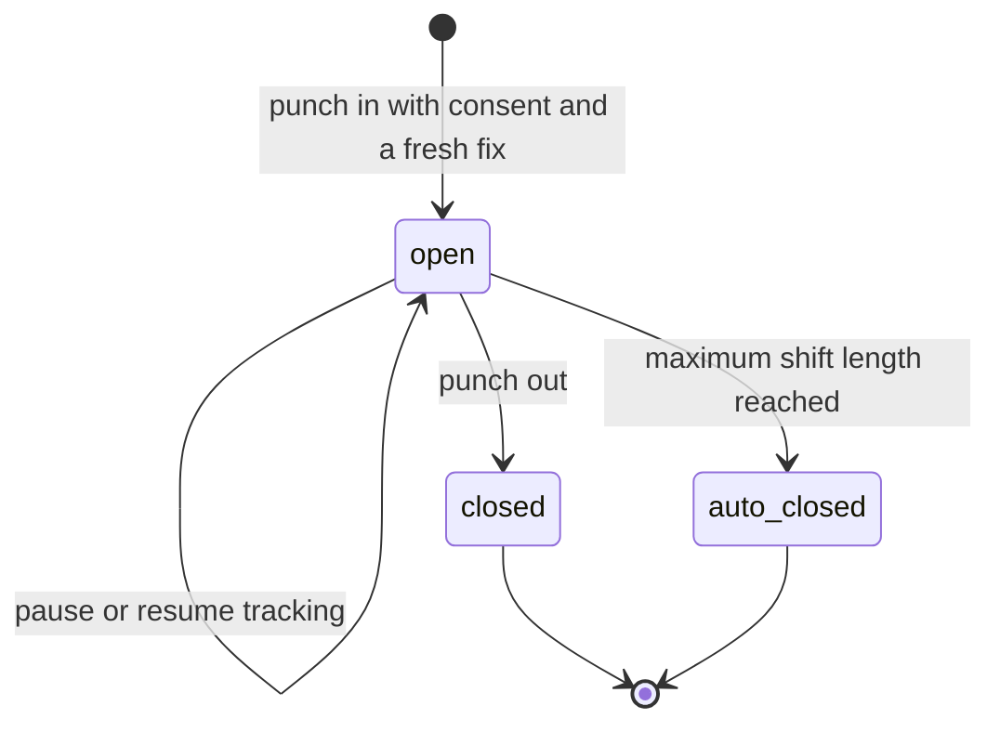

Visit

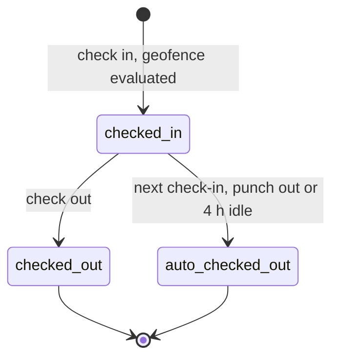

Submission

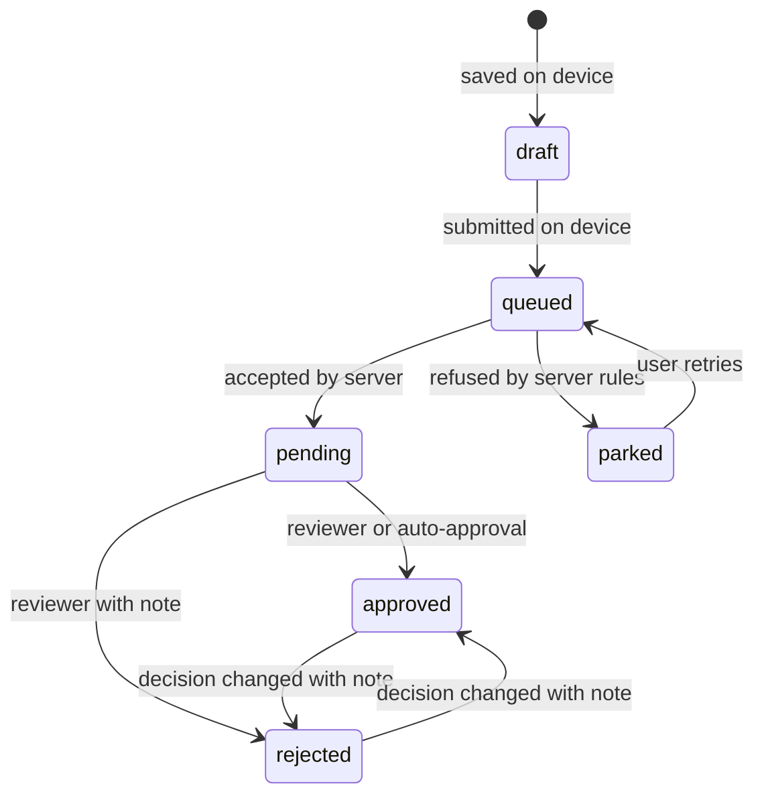

Plan item

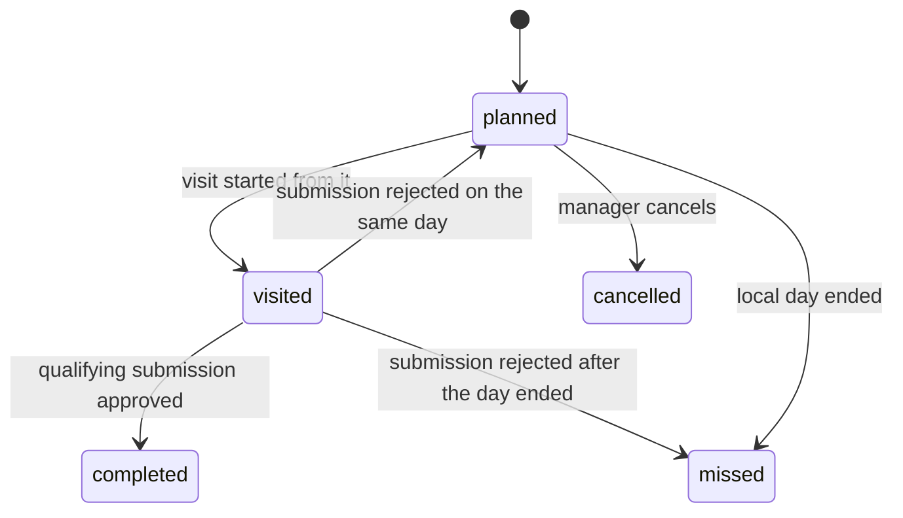

Target set

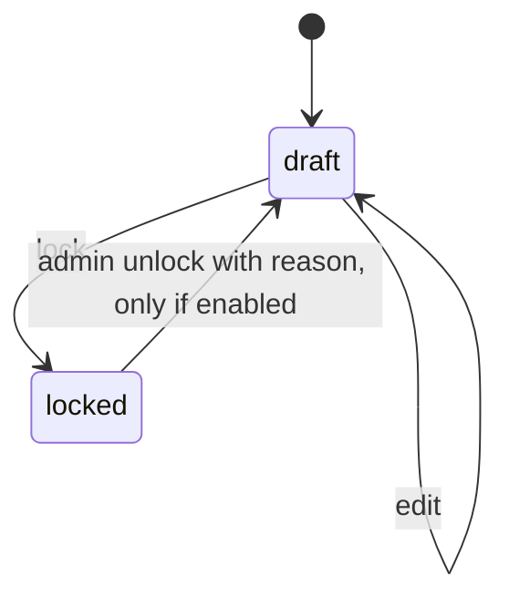

Order

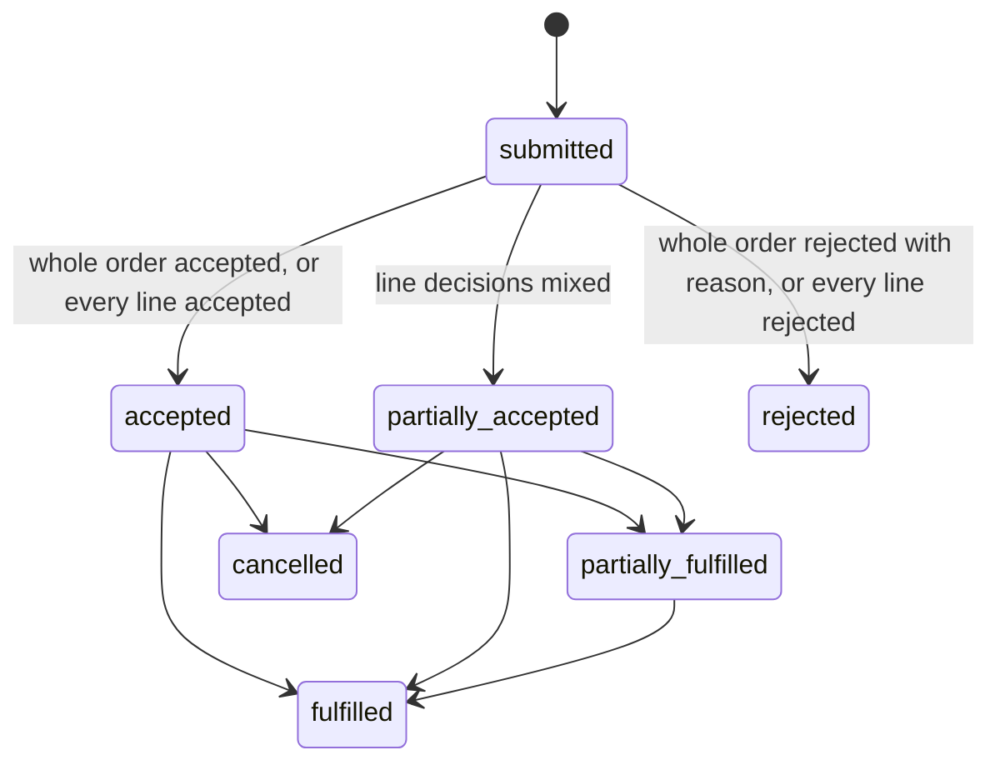

Workflow instance (leave, regularisation, claim, order, new account, location change, tour plan)

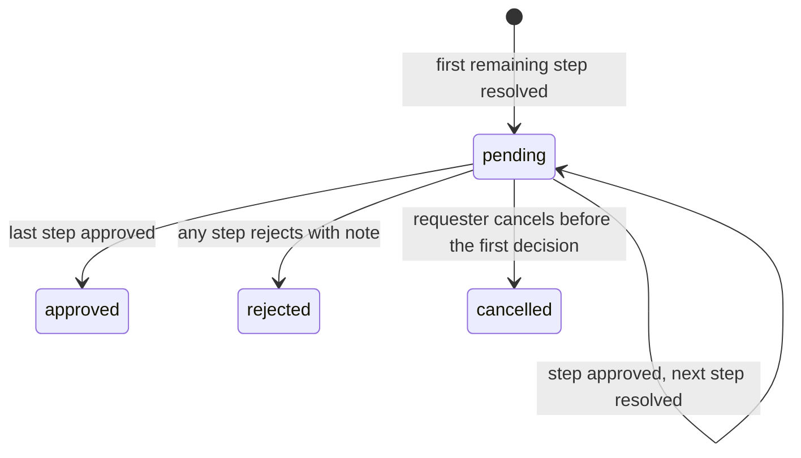

Media

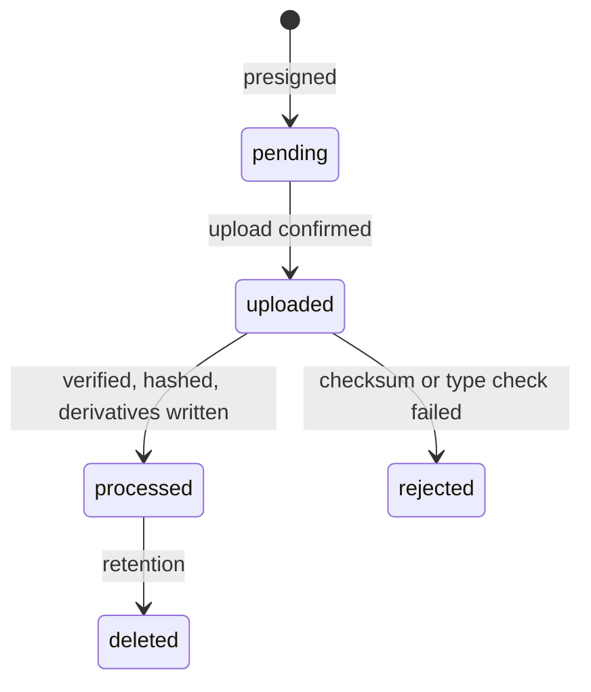

Outbox item on the device

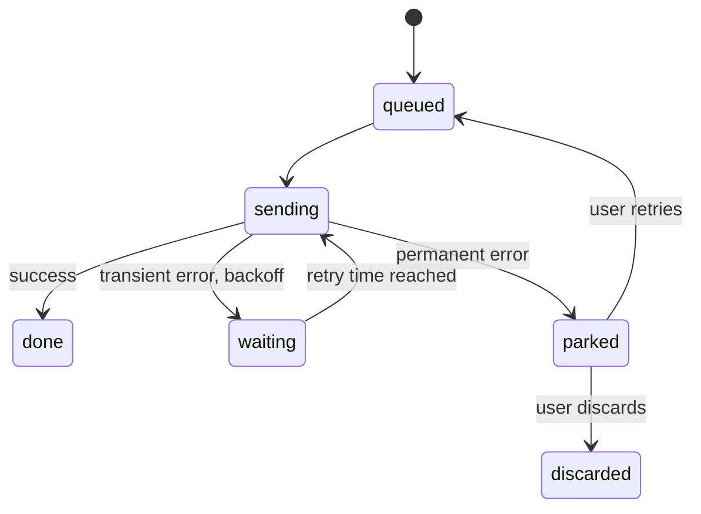

Tenant

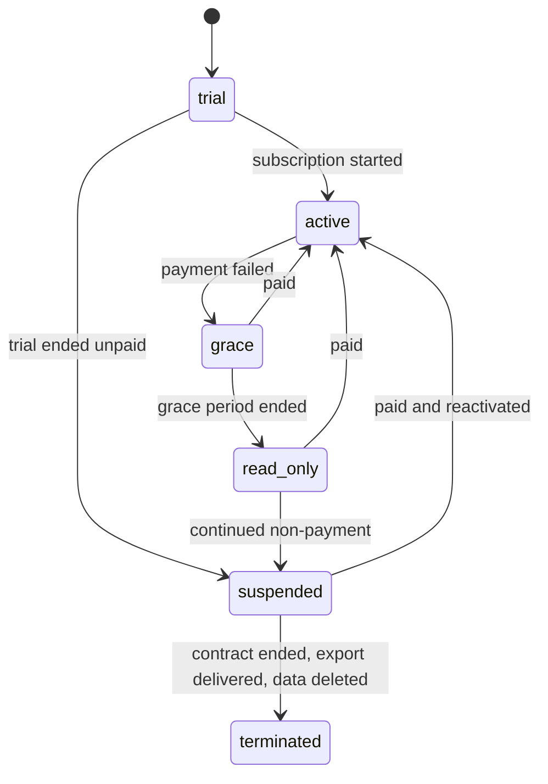

## Appendix D. Worked examples (test fixtures)

Each example becomes at least one automated test.

| ID | Rule | Input | Expected |
|---|---|---|---|
| FX-01 | BR-06 | Targets: sales 1,000, collection 1,000, liquidation 1,000, activities 4. Actuals: 2,000, 500, 0, 2. Equal weights of 25; cap 1.0. | Ratios 1, 0.5, 0, 0.5; score 50 |
| FX-02 | BR-06 | As FX-01, but the target set is a draft | Not ranked |
| FX-03 | BR-06 | Locked target set with a collection target of 0 | Not ranked |
| FX-04 | BR-07 | Scores 80, 80 and 70, plus one unranked user | Ranks 1, 1, 3; the unranked user is listed last without a rank |
| FX-05 | BR-02 | Two approved and one pending submission of a counted form | Value 2; pending 1 shown separately |
| FX-06 | BR-04 | User A: 10 order lines over 5 productive visits. User B: 2 lines over 2 visits. | Team lines per call = 12 ÷ 7 = 1.71 (averaging the users' ratios would give 1.5) |
| FX-07 | BR-10 to BR-13 | 2 cases × 12 packs, price 400.00 per pack, discount 10%, tax 18% | Net rate 360.00; 24 packs; taxable 8,640.00; tax 1,555.20; total 10,195.20 |
| FX-08 | BR-12, BR-13 | 3 cases × 12 packs at a net rate of 90.23, tax 18% | Taxable 3,248.28; tax 584.69; total 3,832.97 |
| FX-09 | BR-10 | Price 99.99, discount 12.5% | Net rate 87.49 (from 87.49125), rounded before multiplying by quantity |
| FX-10 | BR-11 | 5 cases × 12 packs of 500 ML | 60 packs; 30.000 L |
| FX-11 | BR-16 | Pack "500 ML", 12 per case, measure per base unit 0.5 L | Valid; with 0.4 L, invalid |
| FX-12 | BR-17 | Discount cell 0.1 and tax cell 0.18, mapping marks fractions | Discount 10%, tax 18% |
| FX-13 | BR-14 | Device quoted a 10% discount; the applicable price list now gives 12% | `PRICE_CHANGED` |
| FX-14 | BR-19 | Line decisions: accept, reject (No stock) | Order `partially_accepted` |
| FX-15 | BR-21 | Opening balance 1,000.00; debit 10,000.00; credit 3,000.00 | Running balances 11,000.00, then 8,000.00 |
| FX-16 | BR-20 | Outstanding 50,000; buckets 20,000, 20,000 and 10,000.02 | Rejected: the sum exceeds outstanding by more than 0.01 |
| FX-17 | BR-26 | Gross 30,000; 3.5 paid days of 5 scheduled | 21,000.00 |
| FX-18 | BR-26 | No scheduled days in the period | 0.00 |
| FX-19 | BR-23 | A day with a shift and approved paid leave | `present` (1) |
| FX-20 | BR-27 | Leave from Friday to Monday; Sunday is a weekly off and Saturday a holiday | 2 days |
| FX-21 | BR-29 | Per km; odometer 1,000 to 1,042; rate 8 | 42 km; 336.00 |
| FX-22 | BR-29 | Per day; 3 days at 500; per-claim cap 1,200 | 1,200.00 |
| FX-23 | BR-31 | Requester's manager is the business head; chain is reporting manager, then business head | One pending step, with the business head as approver |
| FX-24 | BR-31 | The business head tries to act while the request waits at the reporting manager's step | `NOT_CURRENT_APPROVER` |
| FX-25 | BR-31 | Two approvers act on the same step at the same moment | One succeeds; the other receives 409 |
| FX-26 | BR-32 | GPS fix 150 s older than the capture time | `GPS_STALE` |
| FX-27 | BR-32 | Photo taken 700 m from the submission point | Rejected |
| FX-28 | BR-33 | Radius 300, distance 360, accuracy 80, cap 100 | Inside (360 ≤ 380) |
| FX-29 | BR-33 | Radius 300, distance 420, accuracy 200, cap 100 | Outside (420 > 400) |
| FX-30 | BR-36 | A batch of two points, one mocked | One accepted; one rejected with reason `mocked` |
| FX-31 | BR-36 | A point captured 90 s after punch-out | Rejected with reason `outside_shift` |
| FX-32 | BR-42 | "A Verma" when both Asha Verma and Anil Verma exist | Ambiguous; the row fails |
| FX-33 | BR-42 | "Asha Verrma" when Asha Verma is the only close candidate | Matched (similarity 0.9) |
| FX-34 | BR-44 | Device time 14 minutes behind server time | Records since the last good sync flagged `clock_skew` |
| FX-35 | BR-45 | In a 30-day month: A active all month; B activated on day 16; C deactivated on day 10 | 3 seats; B prorated at 15/30; C counted in full |
| FX-36 | BR-46 | The same order ID sent again with an identical body, then with a changed quantity | First returns the original order; second returns `IDEMPOTENCY_CONFLICT` |
| FX-37 | BR-35 | Plan item visited; the submission is rejected after local midnight | `missed` |
| FX-38 | BR-47 | Subtotal ₹10,000 at 18%; seller in Maharashtra (27); buyer in Maharashtra, then in Karnataka (29) | CGST ₹900 and SGST ₹900; then IGST ₹1,800; ₹11,800 both times |
| FX-39 | BR-47 | Annual, 10 seats committed at ₹12,000 a year; 13 people active in quarter 2 | 3 seats for 9 months at ₹9,000 each: ₹27,000; the commitment becomes 13 |
| FX-40 | BR-48 | Overdue since 4 November; 7 days' grace, 14 read only | Grace to 10 November, read only from 11 November, suspended from 25 November |
| FX-41 | BR-49 | A licence expiring on 31 March 2027 | Valid on 31 March; in grace from 1 to 30 April; read only from 1 May |

## Appendix E. Permission catalogue

Permissions are strings of the form `<area>.<action>`. Roles hold lists of them, and the role carries the data scope.

| Area | Permissions |
|---|---|
| Field | `shift.use`, `tracking.pause`, `visit.use`, `submission.create`, `account.propose`, `account.propose_location` |
| Review | `submission.review`, `submission.review_bulk`, `review_rules.manage` |
| Planning | `target.view`, `target.edit`, `target.lock`, `target.unlock`, `route.manage`, `plan_item.manage`, `account_plan.manage` |
| Performance | `performance.view_team`, `leaderboard.view`, `metric.record` (loading external metric values, decision D94) |
| Maps | `live_map.view`, `trail.view` |
| People | `user.view`, `user.manage`, `user.reset_device`, `user.sign_out_all`, `role.manage`, `designation.manage` |
| Territories and accounts | `territory.manage`, `account.view`, `account.manage`, `account.import`, `account.approve` |
| Configuration | `settings.manage`, `terminology.manage`, `form.manage`, `metric.manage`, `workflow.manage`, `policy.manage`, `notification_template.manage`, `module.manage` |
| Catalogue and orders | `catalogue.manage`, `price_list.manage`, `order.create`, `order.create_without_shift`, `order.view`, `order.decide`, `order.line_decide`, `order.fulfil` |
| Finance | `finance.view`, `finance.manage` |
| People operations | `leave.request`, `regularisation.request`, `expense.claim`, `approval.act`, `calendar.manage`, `leave_type.manage`, `expense_policy.manage`, `expense.mark_paid`, `payroll.manage`, `payslip.view` |
| Data | `report.view`, `export.create`, `import.run`, `audit.view` |
| Integrations and billing | `api_client.manage`, `webhook.manage`, `billing.manage` |
| Platform (vendor staff only) | `platform.tenant.manage`, `platform.plan.manage`, `platform.support.request`, `platform.support.approve_emergency`, `platform.flags.manage`, `platform.billing.manage`, `platform.staff.manage` (inviting and disabling vendor staff, decision D88) |

## Appendix F. Environment variables

API, workers and scheduler (production values come from Secrets Manager or task definitions):

| Variable | Purpose |
|---|---|
| `NODE_ENV`, `PORT`, `CELL_ID`, `PRODUCT_SLUG`, `PRODUCT_NAME` | Runtime basics; the name appears on photos' stamps |
| `CELL_API_URL`, `CELL_REGION` | Where apps reach this cell, as the directory hands it out at sign-in, and its region |
| `DATABASE_URL`, `DATABASE_REPLICA_URL` or `DATABASE_REPLICA_HOST`, `DATABASE_MIGRATOR_URL`, `DB_POOL_MAX` | Application role; the read replica, as a URL or as a host that takes the application role's URL (D98); migration role; pool size |
| `REPORT_STATEMENT_TIMEOUT_MS`, `EXPORT_STATEMENT_TIMEOUT_MS` | How long one statement of a report on screen (30 s) or of an export (5 min) may run (D98) |
| `DIRECTORY_DATABASE_URL` | Directory schema connection, used by the directory module only |
| `REDIS_URL` | TLS URL in cloud environments |
| `OUTBOX_RELAY`, `OUTBOX_POLL_MS`, `SCHEDULER_TICK_MS` | Whether a process runs the outbox relay (the worker does by default) and how often it polls; how often the scheduler looks for tenants' scheduled moments |
| `SYNC_EPOCH` | Carried by every sync cursor; raising it after the cell's database is restored or moved makes every phone take a full copy (decision D40) |
| `JWT_SIGNING_KEY` (directory), `JWKS_URL` (cells), `OTP_PEPPER`, `COLUMN_KEY` | Token signing and verification, OTP hashing, the AES-256 key for encrypted columns, kept in Secrets Manager under KMS (decision D88) |
| `CONSOLE_URL` | Where the platform console runs, for vendor staff's setup links (decision D88) |
| `OBJECT_STORE`, `S3_BUCKET`, `S3_REGION`, `S3_ENDPOINT`, `S3_ACCESS_KEY_ID`, `S3_SECRET_ACCESS_KEY`, `CLOUDFRONT_DOMAIN`, `CLOUDFRONT_KEY_ID`, `CLOUDFRONT_PRIVATE_KEY` | Media storage and signed reads. `OBJECT_STORE` is `s3`, or `memory` in tests only. The endpoint and keys are MinIO's locally; in AWS they stay unset, and the task's role signs requests (decision D42). |
| `OTP_PROVIDER`, `SMS_PROVIDER`, `SMS_API_KEY`, `SMS_TEMPLATE_IDS` | OTP and SMS; `console` is allowed only locally |
| `WHATSAPP_PROVIDER`, `WHATSAPP_API_KEY`, `WHATSAPP_SENDER_ID` | WhatsApp templates |
| `FCM_PROJECT_ID`, `FCM_SERVICE_ACCOUNT`, `APNS_KEY_ID`, `APNS_TEAM_ID`, `APNS_KEY` or `EXPO_ACCESS_TOKEN` | Push |
| `SES_FROM_ADDRESS` | Email |
| `OCR_PROVIDER` | `none`, or a provider available in-region |
| `PAYMENT_PROVIDER`, `RAZORPAY_KEY_ID`, `RAZORPAY_KEY_SECRET`, `RAZORPAY_WEBHOOK_SECRET` | Billing, directory plane only |
| `LICENCE_PUBLIC_KEY`, `LICENCE_FILE_PATH` | Dedicated deployments |
| `SENTRY_DSN`, `SENTRY_ENVIRONMENT`, `SENTRY_RELEASE`, `OTEL_EXPORTER_OTLP_ENDPOINT` | Observability: error reports go to Sentry only when `SENTRY_DSN` is set, scrubbed of numbers, addresses, codes, tokens and signed URLs (D98) |
| `CLOUDWATCH_METRICS` | The scheduler writes each minute of the cell's health as CloudWatch metrics, for the alarms (D98) |
| `CORS_ORIGINS` | Allowed web origins |
| `MIN_APP_VERSION_ANDROID`, `MIN_APP_VERSION_IOS` | The oldest app version each platform may use; older apps get `UPGRADE_REQUIRED` (M1, rule 8). Unset allows every version. |

Web portal and console: `VITE_DIRECTORY_URL`, `VITE_CELL_URL` (optional; where the portal calls the cell, by default its own origin, which passes `/v1` and `/auth` to the cell; the cell address handed out at sign-in is what Settings › API clients shows integrators), `VITE_PRODUCT_NAME`, `VITE_GOOGLE_MAPS_API_KEY`, `VITE_SENTRY_DSN`, `VITE_PRIVACY_EMAIL` (the provider's privacy address on the public privacy and account deletion pages; without it they point to the store page).

Mobile (EAS environment): `EXPO_PUBLIC_DIRECTORY_URL`, `EXPO_PUBLIC_SENTRY_DSN`, `EXPO_PUBLIC_PRIVACY_EMAIL` (as `VITE_PRIVACY_EMAIL`, for the app's Privacy screen), `GOOGLE_MAPS_ANDROID_KEY`, `APP_VARIANT`, `EAS_PROJECT_ID`, and `PRODUCT_SLUG` and `PRODUCT_NAME`, from which the app's name and store identifiers derive. The cell URL comes from the sign-in response, never from the build.

## Appendix G. Glossary

| Term | Meaning |
|---|---|
| Account | Any external party the field team works with: distributor, retailer, doctor, outlet, dealer, site |
| Account plan | Planned monthly values for an account, separate from users' targets |
| Account type | A tenant-defined class of account with its own fields, slots and rules |
| Active days | Local dates with at least one approved qualifying submission |
| Assignment slot | A named role on an account (for example regional manager or field user) filled by a user |
| Cell | A complete data-plane deployment serving a set of tenants |
| Config bundle | The tenant configuration a client downloads: settings, terminology, forms, metrics, permissions |
| Coverage | The share of assigned accounts visited in a period |
| Designation | Job title with a hierarchy level, separate from role |
| Directory plane | Global services: identities, the tenant-to-cell map, billing and the platform console |
| DLT | India's registry for commercial SMS senders and templates |
| Form version | An immutable published version of a form, referenced by its submissions |
| Geofence | A radius around an account's verified location, used to judge whether a visit happened on site |
| Journey plan | Routes and dated plan items that tell a field user whom to visit |
| Metric | A tenant-defined measure computed per user per day from submissions, visits, orders or external data |
| Outbox (device) | The phone's ordered queue of unsent work |
| Outbox (server) | The table of domain events written with each change for reliable dispatch |
| Plan item | One planned visit to one account on one date |
| Primary and secondary order | An order on the company, or an order on a parent account (an outlet ordering through its distributor) |
| Provisional pay | An attendance-based pay estimate, separate from statutory payroll |
| RLS | PostgreSQL row-level security, enforcing tenant isolation in the database |
| Route | A recurring list of accounts used to generate plan items (beat, PJP, call pattern) |
| Score | Weighted, capped attainment across scored metrics; indicative |
| Seat | A billable active user in a period (BR-45) |
| Segment | A tag on an account set by tenant rules (for example commercially active or A-class) |
| Shift | The time between punch-in and punch-out, up to the maximum length |
| Submission | One filled form, the unit of field activity |
| Sync window | The longest allowed delay between capture and upload |
| Template | A versioned industry configuration bundle applied when a tenant is created |
| Tenant | One customer company and all its data |
| Visit | A checked-in period at an account that holds submissions and orders |

When a decision in section 16 is made or a rule changes, update this file and `docs/decisions.md` in the same pull request.
